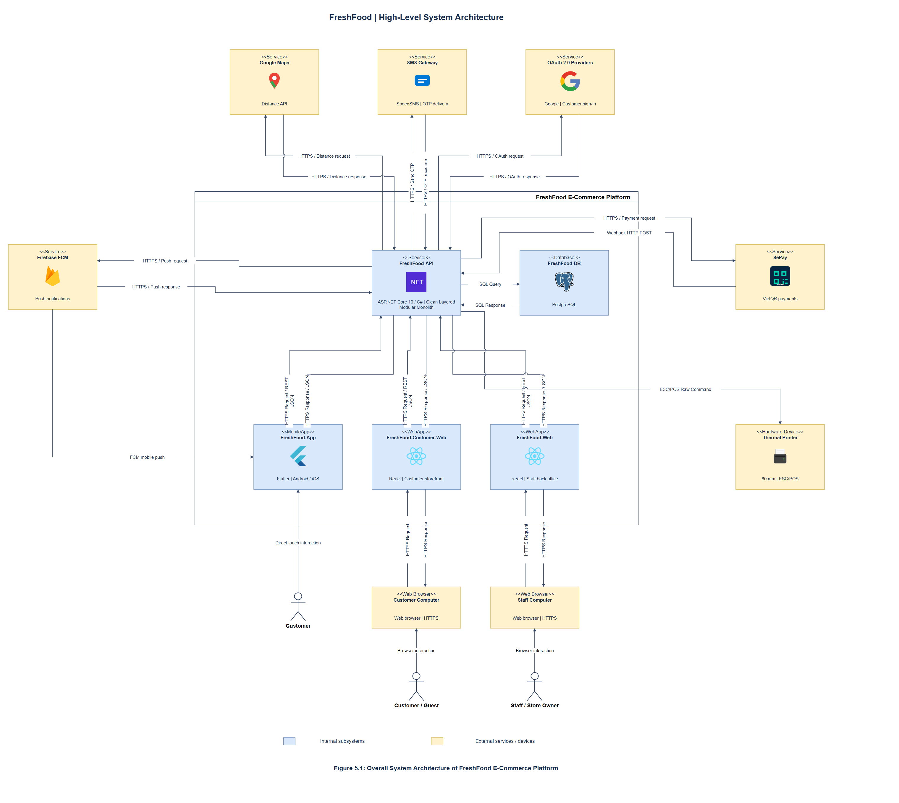

# FreshFood System — High-Level Architecture Specification

**System Name:** FreshFood — Local Organic Food E-Commerce Platform  
**Document Version:** 1.1 (Customer Web Revision - Pending Architecture Review)  
**Lifecycle Phase:** 07A — High-Level Architecture Design  
**Governing Standard:** ISO/IEC/IEEE 42010:2011 (Systems and software engineering — Architecture description) & Karl Wiegers Software Requirements Standard  
**Precedence:** `AGENTS.md` §4, `.agents/Rules/design-rules.md`, `.agents/skills/software-design/SKILL.md`  
**Language Policy:** Mandatory English for Technical Specifications (Project Workspace Policy §2.5)  

---

## Document Control & Record of Changes

| Version | Date | Status / Action | In Charge | Change Description |
|:---:|:---:|:---:|:---:|---|
| **1.0** | 2026-10-17 | A (Added) | Software Architect / SE Lifecycle Agent | Initial High-Level Architecture specification synthesized from baselined Functional Requirements, Non-Functional Requirements (ISO/IEC 25010), Business Rules, and System Constraints. |

| **1.1** | 2026-10-26 | M (Modified) | User-directed architecture revision | Separate Customer Web storefront from staff back office; retain Customer Mobile App; synchronize diagrams, specification and traceability. Pending architecture review. |

*Action codes: A = Added, M = Modified, D = Deleted*

---

# 1. Architectural Drivers Synthesis

The architecture of the FreshFood system is directly shaped and justified by four major driver categories: Functional Requirements & Business Rules, Quality Attributes (Non-Functional Requirements), System Constraints, and External Interfaces.

## 1.1 Functional Requirements & Business Rules Drivers

**Table 5.1: Functional Requirements & Business Rules Architectural Impact**

| Driver Category | Requirement / Rule IDs | Architectural Significance & Technical Impact |
|---|---|---|
| **Catalog & Batch Stock** | `FR-CAT-01..05`, `FR-WHS-01..04`, `BR-BAT-01..04` | Requires batch-level tracking with First-Expired, First-Out (FEFO) automated allocation, discount degradation tiers for near-expiry items, and quarantine/delisting states. Domain models must isolate Batch Inventory from Master Product Catalog. |
| **Storefront & Ordering** | `FR-CUS-01..08`, `BR-ORD-01..03` | Demands stateful cart management, address distance validation ($\le 10\text{ km}$), tiered shipping fee calculation, phone OTP verification prior to checkout, and order status lifecycle state machine. |
| **Order Fulfillment** | `FR-SAL-01..04`, `BR-FUL-01..02`, `BR-ORD-02` | Demands integration with $80\text{mm}$ thermal receipt/packing slip printers, first-time customer telephone verification workflows, delivery dispatching, and automated restock upon delivery failure. |
| **Security & Auditing** | `FR-ADM-01..04`, `BR-SEC-01..04` | Demands Role-Based Access Control (RBAC) with instantaneous privilege revocation ($\le 1.0\text{s}$) and immutable, tamper-resistant database audit logging for all staff mutations with pre/post JSON snapshots and originating IP. |

## 1.2 Quality Attribute Requirements Drivers (ISO/IEC 25010)

**Table 5.2: Quality Attribute Drivers and Architectural Solutions**

| Quality Attribute | Key Metric / Threshold | Architectural Solution & Mechanism |
|---|---|---|
| **Performance Efficiency** (`NFR-PERF-01..06`) | - 100 Peak CCU, 500 registered users.<br>- FCP $\le 1.5\text{s}$, LCP $\le 2.0\text{s}$.<br>- Search/Filter $p95 \le 500\text{ms}$.<br>- Checkout latency $\le 1.0\text{s}$.<br>- VietQR webhook matching $\le 3.0\text{s}$.<br>- Distance calculation $\le 800\text{ms}$. | - **In-Memory Caching & Indexes:** Composite database indexes on `(ProductId, ExpDate)` and `(Status, CategoryId)`. Caching of store coordinates and customer addresses.<br>- **WebP & Static Asset Optimization:** Asset bundling, lazy loading, and CDN delivery for product imagery.<br>- **Lightweight Process:** In-process event dispatcher and asynchronous polling/WebSocket for payment reconciliation. |
| **Data Integrity & Concurrency** (`NFR-INT-01..03`) | - **0% Over-selling Rate**.<br>- 100% accurate batch restock within $\le 1.0\text{s}$.<br>- 0 VND financial rounding error. | - **Database Concurrency Control:** Row-level pessimistic locking (`SELECT ... FOR UPDATE` / serializable transaction boundary) during inventory reservation.<br>- **Relational Foreign Key Constraints:** Strict referential integrity between `OrderDetail` and `BatchInventory`.<br>- **Exact Decimal Types:** All monetary calculations use `Decimal(18,0)` in database and application layers. |
| **Security & Access Control** (`NFR-SEC-01..05`) | - 100% TLS 1.3 / HTTPS.<br>- BCrypt hashing (Work factor $\ge 11$).<br>- RBAC claim enforcement on all API routes.<br>- Token revocation within $\le 1.0\text{s}$.<br>- SMS rate limiting (3 OTPs / 15 min).<br>- Immutable staff mutation audit logging. | - **JWT Bearer Authentication:** Stateless Access Tokens (60-minute expiry) paired with an in-memory/DB Token Blacklist and immediate `IsActive` verification middleware.<br>- **RBAC Authorization Middleware:** Declarative role-based policies (`Customer`, `SalesStaff`, `WarehouseStaff`, `StoreOwner`).<br>- **Database Audit Interceptor:** Cross-cutting EF Core / ORM interceptor capturing all database mutations by staff accounts into `AuditLog`. |
| **Third-Party Resilience** (`NFR-RES-01..02`) | - External API timeout $\le 3.0\text{s}$.<br>- Google Maps failure fallback mechanism. | - **Circuit Breaker & Timeout Policy:** Strict 3.0-second timeout on Google Maps, SePay, and SMS Gateway calls with Polly/resilience policies.<br>- **Graceful Fallback Adapter:** If Google Maps API fails or quota is exhausted, system falls back to ward-level selection with standard 20,000 VND flat fee. |
| **Availability & Reliability** (`NFR-REL-01..02`) | - 99.5% uptime (06:00–22:00).<br>- Automated daily backup at 01:00 AM (RPO $\le 24\text{h}$, RTO $\le 2\text{h}$). | - **Monolithic In-Process Resilience:** Avoids distributed network points of failure. Health check endpoints (`/health`). Automated PostgreSQL dump and offsite backup replication. |
| **Maintainability & Testability** (`NFR-MNT-01..04`) | - Clean Layered Architecture with loose coupling via Interfaces and Dependency Injection.<br>- Centralized external configuration.<br>- Unit test coverage $\ge 75\%$.<br>- Structured logging with `TraceId` / `CorrelationId`. | - **Strict Layer Isolation:** Clean separation between Presentation, Application, Domain, and Infrastructure layers.<br>- **Inversion of Control (IoC):** All services injected via interfaces.<br>- **Serilog Structured Logging:** JSON log sink with correlation identifiers and contextual metadata. |
| **Reusability** (`NFR-REU-01..04`) | - Reusable Domain Services.<br>- Shared UI component library ($\ge 80\%$ reuse).<br>- Pluggable Adapters for external gateways.<br>- Shared Common utilities. | - **Core Domain Services:** `DistanceCalculator`, `ShippingFeeCalculator`, `BatchStockValidator` located in `FreshFood.Domain`.<br>- **Adapter Pattern:** `IPaymentGateway` (`SePayAdapter`, `CodAdapter`), `ISmsService` (`SpeedSmsAdapter`), `IMapService` (`GoogleMapsAdapter`, `HaversineFallbackAdapter`). |

## 1.3 Constraints Drivers

**Table 5.3: Constraints and Architectural Realization**

| Constraint ID | Constraint Statement | Architectural Realization |
|---|---|---|
| **CON-01** | Operational Delivery Radius $\le 10\text{ km}$ | Enforced at the Domain Service layer by `DistanceCalculator` and validated during cart checkout before order creation. |
| **CON-02** | Strict FEFO Ordering | Query specification pattern ordering available inventory batches by `ExpDate ASC` with row-level locks. |
| **CON-03** | SMS Phone Verification Prerequisite | Checkout endpoint verifies `Customer.PhoneVerified == true`; otherwise rejects with validation error. |
| **CON-04** | Integer VND Financial Precision | All financial models, database columns, and DTOs use `Decimal(18,0)` without fractional floating points. |
| **CON-05** | Browser-Accessible Back-Office | Storefront and Back-Office Admin are architected as zero-install responsive web applications. |

## 1.4 External Interface Drivers

- **Google OAuth 2.0 / Facebook Login:** External identity providers for customer single sign-on.
- **SePay VietQR Payment Gateway:** Webhook callback listener requiring TLS, HMAC signature verification, and idempotent transaction processing.
- **SpeedSMS / Telecom SMS Gateway:** REST client delivering 6-digit OTP codes with rate limiting.
- **Google Maps Distance Matrix API:** REST client computing driving distance, wrapped in fallback-capable adapter.
- **Thermal Printer (ESC/POS):** Local/network printer adapter generating raw ESC/POS binary receipts for order fulfillment slips.

---

# 2. Architectural Style Evaluation & Selection

## 2.1 Evaluated Architectural Styles

Three primary architectural styles were formally evaluated against the FreshFood system context (100 CCU, 500 users, single retail store, strict consistency requirements):

1. **Microservices Architecture:**
   - *Description:* Decomposing the system into independently deployable micro-services (Catalog Service, Inventory Service, Order Service, Payment Service, Delivery Service).
   - *Evaluation:* While offering independent scaling, it introduces severe distributed transaction complexity (requiring Saga patterns or Two-Phase Commit to guarantee zero over-selling across Inventory and Orders). Network latency between services poses a major risk to sub-second response times on modest cloud hosting. Operational overhead (API gateways, service discovery, container orchestration) is entirely disproportionate to a 100 CCU workload.
   - *Decision:* **REJECTED** (Premature over-engineering; negative return on investment).

2. **Monolithic Architecture (Traditional / Monolithic MVC):**
   - *Description:* A single unified application codebase where UI, business logic, and data access are bundled into traditional MVC controllers and active record models.
   - *Evaluation:* Simple to build initially, but easily degenerates into tightly coupled spaghetti code where database tables are updated directly from controllers, making automated unit testing ($\ge 75\%$ coverage) and audit interceptors difficult to enforce cleanly.
   - *Decision:* **REJECTED** (Fails maintainability and layer isolation standards).

3. **Clean Layered Architecture with Modular Monolith (Selected):**
   - *Description:* A single deployable executable organized into strictly partitioned layers (Presentation, Application Services, Domain Core, Infrastructure/Persistence) and distinct logical bounded contexts (Catalog, Inventory, Ordering, Fulfillment, Identity, Auditing).
   - *Evaluation:* Eliminates network latency between business modules, guarantees ACID transactions within a single database for zero over-selling (`NFR-INT-01`), allows clean separation of concerns via Dependency Injection (`NFR-MNT-01`), and encapsulates external third-party services behind pluggable adapters (`NFR-REU-03`).

## 2.2 Architectural Style Trade-Off Matrix

**Table 5.4: Architectural Style Trade-off Comparison**

| Evaluation Criteria | Weight | Traditional Monolith | Microservices Architecture | Clean Layered Modular Monolith (Selected) |
|---|:---:|:---:|:---:|:---:|
| **Zero Over-Selling (ACID Transaction Consistency)** | High | Moderate (Often polluted) | Low (Distributed transactions complex) | **High (Direct DB ACID transaction boundaries)** |
| **Performance & Low Latency ($p95 \le 500\text{ms}$)** | High | High (In-memory) | Moderate (Network hops between services) | **High (In-memory method invocation, zero hop)** |
| **Maintainability & Testability ($\ge 75\%$ Coverage)** | High | Low (Tight coupling) | High (Isolated services) | **High (Interface-driven loose coupling via DI)** |
| **Deployment & Operational Simplicity** | Medium | High (Single artifact) | Low (Kubernetes, multiple pipelines) | **High (Single container / App Service deployment)** |
| **Cost Efficiency for 100 CCU / 500 Users** | Medium | High (< $20/month VPS) | Low (> $100/month cluster) | **High (0.5–1.0 vCPU, 1–2 GB RAM footprint)** |
| **Pluggability of External Services (Adapters)** | Medium | Low (Hardcoded calls) | High (Adapter services) | **High (Repository & Adapter Pattern)** |
| **Overall Score** | — | **58 / 100** | **52 / 100** | **94 / 100 (WINNER)** |

## 2.3 Architectural Decision Record (ADR-01)

- **Decision:** Adopt a **Clean Layered Architecture combined with a Modular Monolith** deployment pattern.
- **Status:** Baselined for Phase 07A.
- **Consequences:**
  - All communication between bounded contexts (e.g., Order creation invoking Batch Inventory reservation) occurs via in-process Application Services and Domain interfaces.
  - Transactions are governed by local database transaction managers, completely eliminating distributed 2PC or eventual consistency lags.
  - External dependencies (Payment, SMS, Maps, Printers) are strictly isolated behind Ports (Domain Interfaces) and Adapters (Infrastructure Implementations).

---

# 3. High-Level Subsystem & Component Decomposition

The FreshFood platform architecture is modeled and organized into five core internal subsystems enclosed within the **FRESHFOOD SYSTEM** boundary, interacting with external cloud gateways, client terminals, and hardware peripherals through well-defined collaboration protocols:



**Figure 5.1: Overall System Architecture of FreshFood Organic E-Commerce Platform**

## 3.1 Subsystem Decomposition & Boundary Responsibilities

Customer access is deployed through two distinct presentation subsystems: FreshFood-Customer-Web in web browsers and FreshFood-App on Android/iOS. Both call the same FreshFood-API; FreshFood-Web remains the staff/owner back office. This channel separation does not add business functionality, database entities, or external interfaces. Web push behavior is TBD - Stakeholder confirmation required; the existing Firebase mobile push integration is retained.

**Table 5.5: Subsystem Descriptions and Boundary Responsibilities**

| Subsystem / Component Name | Stereotype / Tech | Primary Responsibilities | Handled Protocols & Collaborations |
|---|---|---|---|
| **FreshFood-API** | `<<Service>>`<br>ASP.NET Core 10 / C# | Core backend application service orchestrating business rules, user authentication, catalog management, FEFO inventory batch allocation, order state transitions, SePay webhook processing, database transaction management, and ESC/POS receipt generation. | HTTPS REST JSON APIs, SQL Queries/Responses, Webhook HTTP POST, ESC/POS Commands |
| **FreshFood-App** | `<<MobileApp>>`<br>Flutter | Cross-platform mobile application dedicated to Customers (Android / iOS). Enables browsing organic produce, batch-aware clearance items, shopping cart management, delivery address validation ($\le 10\text{ km}$), order checkout, real-time order tracking, and push notifications. | Touch Interaction (Customer), HTTPS Requests/Responses to `FreshFood-API`, Firebase FCM push |
| **FreshFood-Web** | `<<WebApplication>>`<br>React | Staff and Store Owner back-office web application: goods receipt, order fulfillment and dispatch, user and audit management, and revenue reports. Customer storefront responsibilities are separated into FreshFood-Customer-Web. | Browser HTTPS from Admin Computer; REST JSON APIs to `FreshFood-API` |
| **FreshFood-Customer-Web** | `<<WebApplication>>`<br>React | Customer browser storefront for existing customer use cases: browse and search products, manage cart, checkout, profile and address management, and order tracking. Shares business rules, authentication and authorization enforcement, and persistent data through FreshFood-API with FreshFood-App. | Browser HTTPS; REST JSON APIs to `FreshFood-API`; no direct database connection. |
| **FreshFood-DB** | `<<Database>>`<br>PostgreSQL | Enterprise relational database management system hosting transactional tables, product catalog, batch inventory lot codes, user accounts, order records, and immutable staff audit logs with pessimistic row-level locking (`ROWLOCK / UPDLOCK`). | SQL Queries and SQL Responses (TCP/IP connection pooling with `FreshFood-API`) |
| **SePay Gateway** | `<<Service>>`<br>VietQR / SePay | External automated payment reconciliation gateway. Monitors store bank account transactions, matches order payment references, and delivers instant credit transaction notifications. | Incoming Webhook HTTP POST to `FreshFood-API`, HTTPS Response confirmation |
| **Google Maps** | `<<Service>>`<br>Maps API | External geospatial routing service computing driving distances from store origin to customer delivery address. Enforces operational delivery boundary ($\le 10\text{ km}$) and tiered fee calculation. | HTTPS Requests/Responses (wrapped in 3.0s timeout and Haversine fallback adapter) |
| **SpeedSMS** | `<<Service>>`<br>SMS Gateway | External telecom SMS gateway delivering 6-digit one-time passwords (OTP) to verify customer phone numbers prior to order placement (`BR-ORD-01`). | HTTPS Requests/Responses (rate-limited to 3 OTPs / 15 minutes) |
| **Firebase (FCM)** | `<<Service>>`<br>Firebase | Cloud messaging infrastructure delivering real-time push notifications to customer mobile devices upon order status changes (Confirmed, Packing, Dispatched, Delivered). | HTTPS Requests/Responses to/from `FreshFood-API`, push delivery to `FreshFood-App` |
| **Google / OAuth** | `<<Service>>`<br>OAuth 2.0 | External federated identity provider facilitating customer Single Sign-On (SSO) authentication and identity verification. | HTTPS Requests/Responses, OAuth 2.0 Authorization Code Flow |
| **Thermal Printer** | `<<Hardware>>`<br>80mm ESC/POS | Hardware POS receipt printer situated at the store packaging counter, automatically printing physical fulfillment slips and customer sales invoices. | Binary ESC/POS commands transmitted over local TCP/IP or USB connection from `FreshFood-API` |
| **Admin Computer** | `<<Web Browser>>` | Workstation terminal utilized by store personnel (Warehouse Staff, Sales Staff, Store Owner) to operate back-office management modules via web browser. | Browser Use (Staff/Owner), HTTPS Requests/Responses to `FreshFood-Web` |

---

# 4. Critical Architectural Mechanisms & Quality Attribute Realizations

## 4.1 Zero Over-Selling & Concurrency Control Mechanism (`NFR-INT-01`)
To guarantee an over-selling rate of **strictly 0%** when multiple customers concurrently purchase the last remaining stock of a perishable organic batch:
1. When `OrderAppService.Checkout()` executes, it opens an isolated database transaction (`IsolationLevel.ReadCommitted` or `RepeatableRead`).
2. The inventory reservation queries the candidate batches using row-level locking:
   ```sql
   SELECT BatchId, CurrentQty, ReservedQty, ExpDate 
   FROM BatchInventory WITH (ROWLOCK, UPDLOCK)
   WHERE ProductId = @ProductId AND Status = 'Active' AND ExpDate > CURRENT_DATE
   ORDER BY ExpDate ASC;
   ```
3. The application allocates quantities strictly in FEFO order (`BR-BAT-02`).
4. If available stock (`CurrentQty - ReservedQty`) $\ge$ requested quantity, `ReservedQty` is incremented and the transaction commits.
5. If stock is insufficient, the transaction rolls back immediately and returns an out-of-stock validation error within $\le 500\text{ms}$.

## 4.2 Automated VietQR Payment Reconciliation Mechanism (`NFR-PERF-05`)
1. Upon checkout, system creates order with `OrderStatus = 'Pending'` and `PaymentStatus = 'Unpaid'`.
2. Storefront displays dynamic VietQR image containing store account number, transfer amount, and unique order payment reference: `FFORD{OrderId}`.
3. Customer transfers money via banking app.
4. SePay gateway detects credit transaction and sends an encrypted HTTP POST webhook to `/api/v1/payments/sepay-webhook`.
5. Webhook handler:
   - Validates webhook signature (`HMAC-SHA256`).
   - Checks idempotency key (preventing duplicate processing of duplicate webhook retries).
   - Extracts `OrderId` from payment description.
   - Atomically updates `PaymentStatus = 'Paid'` and moves `OrderStatus = 'Processing'`.
   - Fires internal notification to Sales Staff fulfillment dashboard via WebSocket / polling. Total roundtrip latency: $\le 3.0\text{s}$.

## 4.3 Third-Party Map Service Resilience & Fallback (`NFR-RES-01`, `NFR-RES-02`)
1. Storefront checkout invokes `IMapService.CalculateDistance(storeOrigin, customerDestination)`.
2. `GoogleMapsAdapter` executes the HTTP request wrapped in a 3.0-second timeout policy.
3. If Google Maps returns HTTP 200 within 3.0s:
   - Distance is returned.
   - If distance $\le 10\text{ km}$, `ShippingFeeCalculator` calculates tiered fee (`10k / 20k / 30k` per `BR-DEL-02`).
   - If distance $> 10\text{ km}$, order is rejected with clear Vietnamese error message per `BR-DEL-01`.
4. If Google Maps times out ($> 3.0\text{s}$), returns 5xx error, or exceeds quota:
   - System activates `HaversineFallbackAdapter` or prompts customer to select their local Ward/District from a pre-configured dropdown list.
   - Applies standard fallback shipping fee of **20,000 VND** (`NFR-RES-02`).
   - Order creation proceeds without blocking the customer.

## 4.4 Immediate Token Revocation & Role Enforcement (`NFR-SEC-02`, `NFR-SEC-03`)
1. Each staff request carries a Bearer JWT containing `AccountId`, `Role`, and `TokenId (jti)`.
2. The authentication pipeline evaluates JWT cryptographic validity.
3. Before dispatching to controller, `ActiveUserValidationMiddleware` verifies:
   - Account `Status == 'Active'`.
   - Account `TokenRevocationTimestamp < TokenIssuedAt`.
4. When the Store Owner revokes a staff account (`BR-SEC-03`), the database updates `Status = 'Revoked'` and sets `TokenRevocationTimestamp = NOW()`.
5. The very next API request from that staff member fails immediately with `403 Forbidden` within $\le 1.0\text{s}$.

## 4.5 Immutable Staff Database Audit Logging (`NFR-SEC-05`, `BR-SEC-04`, `FR-ADM-04`)
1. An ORM interceptor (`AuditSaveChangesInterceptor`) hooks into the database persistence pipeline.
2. For all mutating operations (`INSERT`, `UPDATE`, `DELETE`) initiated by authenticated Staff/Owner accounts:
   - Interceptor extracts originating `StaffId` and client `IpAddress` from the current execution context.
   - Captures previous state (`OldValues`) and proposed state (`NewValues`) as serialized JSON snapshots.
   - Appends an immutable record into `AuditLog (LogId, StaffId, ActionType, EntityName, RecordId, OldValues, NewValues, IpAddress, Timestamp)`.
3. The audit log entry is saved within the **same atomic database transaction** as the business mutation. If audit writing fails, the business change is aborted.
4. No `UPDATE` or `DELETE` operations are permitted on the `AuditLog` table.

---

# 5. Architecture Traceability Matrix

**Table 5.6: Bidirectional Traceability: Architecture Components to Requirements**

| Subsystem / Architectural Component | Governed Functional Requirements | Governed Non-Functional Requirements | Governed Business Rules & Constraints |
|---|---|---|---|
| **FreshFood-API (ASP.NET Core 10 / C#)** | `FR-CAT-01..05`, `FR-CUS-04..08`, `FR-SAL-01..04`, `FR-WHS-01..04`, `FR-ADM-01..04` | `NFR-PERF-01..06`, `NFR-INT-01..03`, `NFR-SEC-01..05`, `NFR-MNT-01..04` | `BR-BAT-01..04`, `BR-ORD-01..03`, `BR-FUL-01..02`, `BR-SEC-01..04`, `CON-01..04` |
| **FreshFood-App (Flutter Mobile)** | `FR-CUS-01..08` | `NFR-USA-01..03`, `NFR-PERF-01..02` | `BR-ORD-01`, `CON-01`, `CON-03` |
| **FreshFood-Web (React Back Office)** | `FR-WHS-01..04`, `FR-SAL-01..04`, `FR-ADM-01..04` | `NFR-USA-01..03`, `NFR-PERF-02`, `NFR-SEC-02` | `CON-01`, `CON-03`, `CON-05`, `BR-SEC-03` |
| **FreshFood-Customer-Web (React Customer Storefront)** | `FR-CUS-01..08` | `NFR-USA-01..03`, `NFR-PERF-01..02` | `BR-ORD-01`, `CON-01`, `CON-03` |
| **FreshFood-DB (PostgreSQL)** | All Functional Data Records | `NFR-INT-01..03`, `NFR-REL-02`, `NFR-SEC-05` | `BR-BAT-01..04`, `BR-SEC-04`, `CON-02`, `CON-04` |
| **SePay Gateway Adapter** | `FR-CUS-06`, `FR-SAL-02` | `NFR-PERF-05`, `NFR-RES-01` | `BR-ORD-02` |
| **Google Maps Adapter** | `FR-CUS-05` | `NFR-RES-01..02`, `NFR-PERF-06` | `BR-DEL-01..02`, `CON-01` |
| **SpeedSMS Gateway Adapter** | `FR-CUS-04` | `NFR-SEC-04`, `NFR-RES-01` | `BR-ORD-01`, `CON-03` |
| **Firebase FCM Adapter** | `FR-CUS-08`, `FR-SAL-03` | `NFR-PERF-01` | `BR-FUL-01` |
| **Google/OAuth Adapter** | `FR-CUS-04` | `NFR-SEC-01` | `BR-AUTH-01` |
| **Thermal Printer Adapter** | `FR-SAL-02` | `NFR-INT-02` | `BR-FUL-02` |

---

# 6. Verification Gate Status & Review Confirmation

- **Lifecycle Phase:** 07A — High-Level Architecture Design
- **Review Basis:** Functional Requirements Specification, Non-Functional Requirements Specification, Business Rules Catalog, Constraints, System Context.
- **Compliance Checks:**
  - [x] Traceable justification for architectural style (Clean Layered Modular Monolith).
  - [x] Clear subsystem boundaries, responsibilities, and interface contracts.
  - [x] Explicit mechanisms addressing all quality attributes (Concurrency, Latency, Security, Resilience, Testability).
  - [x] Mandatory English language policy enforced across all models and technical descriptions (§2.5).
  - [x] Conformance with Two-Step Diagram generation workflow (§2.8) and Anti-Overlap Invariant (§2.9).
- **Gate Recommendation:** Ready for submission at the Human Verification Gate for Architecture Baseline sign-off before proceeding to Detailed Design (Phase 07B).
