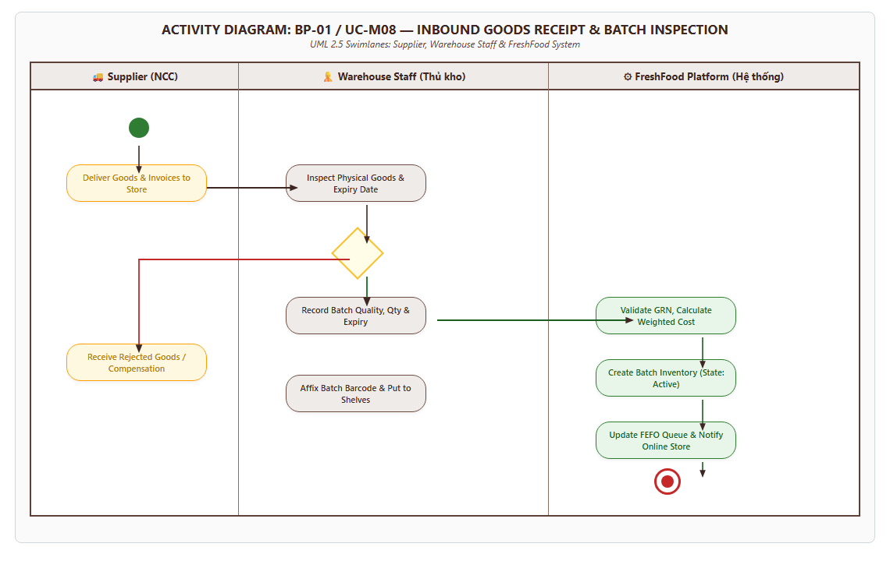
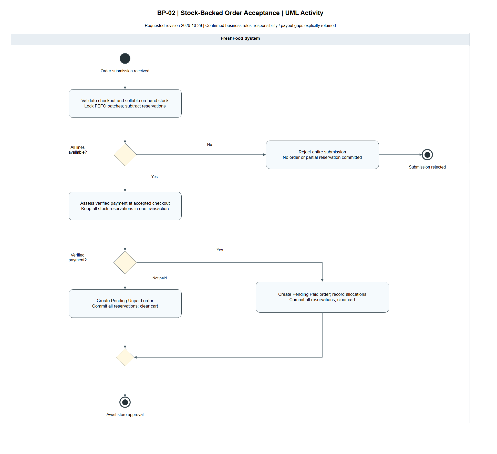
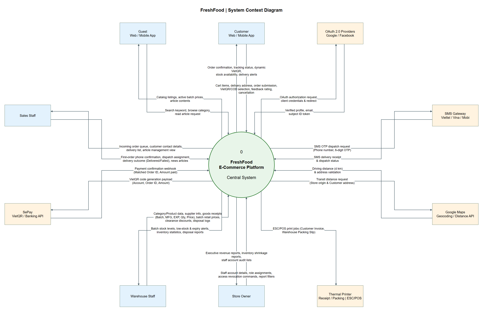
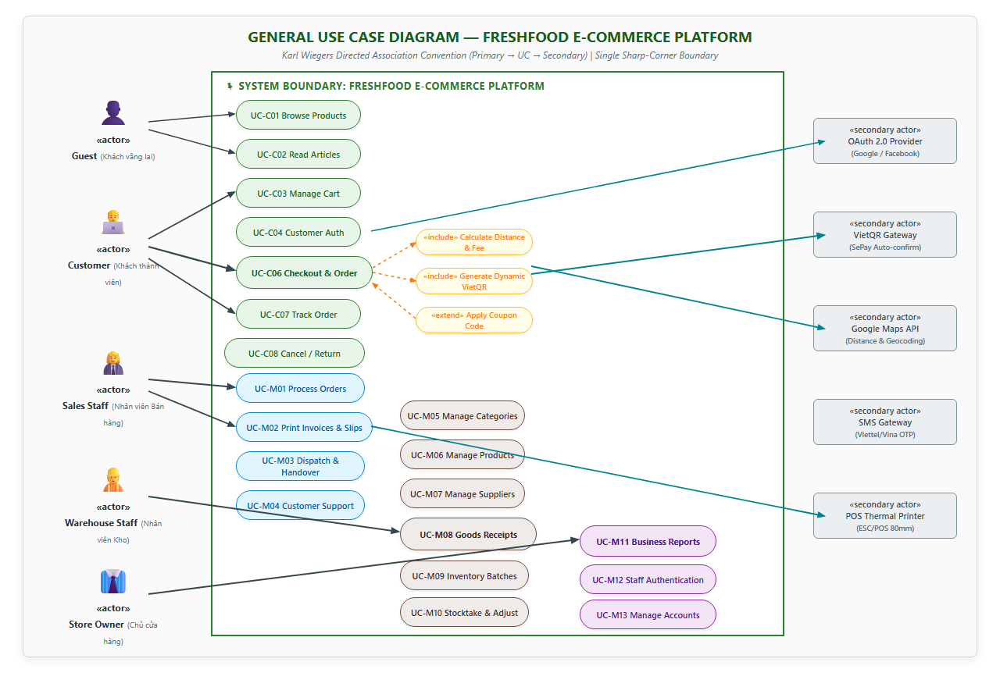

# FreshFood System — Software Requirements Specification (SRS)

**System Name:** FreshFood — Local Organic Food E-Commerce Platform  
**Document Version:** 1.0 (Baselined Requirements Package)  
**Status:** Requirements Phase Deliverable  
**Governing Standards:** 
- Karl Wiegers & Joy Beatty (*Software Requirements*, 3rd Edition)
- ISO/IEC/IEEE 29148:2018 (Systems and software engineering — Life cycle processes — Requirements engineering)
- ISO/IEC 25010:2011 (System and software quality models)  
**Language Policy:** Mandatory English for Engineering Specification (Project Workspace Policy §2.5)

---

## Document Control & Record of Changes

| Version | Date | Status / Action | In Charge | Change Description |
|:---:|:---:|:---:|:---:|---|
| **1.0** | 2026-10-07 | A (Added) | SE Lifecycle Agent | Initial baseline requirements specification synthesized from confirmed stakeholder requirements (`references/User requierement.docx`), Use Case Model, Business Rules, and NFR specifications. |

*Action codes: A = Added, M = Modified, D = Deleted*

---

# CHAPTER I: BUSINESS REQUIREMENTS

## 1.1 Background
FreshFood is an established local retail store specializing in certified organic vegetables, fruits, and fresh meat/poultry. FreshFood serves customers located in the immediate vicinity of the store (within a 10 km operational radius). 

Currently, the store conducts operations through walk-in retail and informal phone/messaging channels. Inventory management, batch expiration tracking, and bookkeeping are handled via manual paper ledgers and disconnected spreadsheets. As demand for organic products grows, this manual approach leads to stockouts, inventory shrinkage from expired products, slow order turnaround times, and lack of customer retention. The FreshFood E-Commerce Platform is commissioned to automate store operations and establish an online storefront.

## 1.2 Business Opportunity
FreshFood aims to capture the growing local demand for clean and organic food by providing a fast, reliable, and convenient online ordering experience. By introducing a localized e-commerce web platform, FreshFood will:
1. Enable local households to browse verified organic catalogs, view fresh arrivals, and order for delivery.
2. Automate warehouse batch inventory control, implementing strict First-Expired, First-Out (FEFO) retail pricing and timely clearance discounts.
3. Streamline sales operations through standardized order verification, automated invoice/packing slip printing, and real-time delivery status updates.
4. Establish brand authority and customer trust through culinary articles and verified product reviews.

## 1.3 Business Objectives
The strategic objectives governing the FreshFood system are quantified in the table below:

**Table 1.1: Business Objectives**

| Business Objective ID | Business Objective Statement | Target / Measurement Criteria |
|:---:|---|---|
| **BO-01** | Expand customer reach and sales revenue through online channels | Achieve at least **35% of total store revenue** through the online platform within 6 months of rollout. |
| **BO-02** | Minimize perishable inventory waste and expired stock shrinkage | Reduce expired food disposal losses by **$\ge 60\%$** through batch-level tracking, automated clearance discounts, and FEFO sales priority. |
| **BO-03** | Accelerate order processing and fulfillment turnaround | Decrease average order turnaround time (order placement to delivery dispatch) from 45 minutes to **$< 20\text{ minutes}$**. |
| **BO-04** | Enhance customer retention and purchase frequency | Attain a repeat purchase rate of **$\ge 40\%$** within 90 days among registered customers. |
| **BO-05** | Eliminate order delivery failures resulting from geographical misrouting | Maintain **$< 1\%$** delivery failure rate by strictly enforcing maximum service distance limits and address verification. |

## 1.4 Success Metrics

**Table 1.2: Success Metrics**

| Success Metric ID | Metric Description | Target / Acceptance Value |
|:---:|---|---|
| **SM-01** | Monthly Online Revenue Growth | $\ge 15\%$ month-over-month growth for the first 2 quarters. |
| **SM-02** | Inventory Shrinkage Rate | Expired inventory value represents $< 2.0\%$ of total imported goods value. |
| **SM-03** | Order Delivery Turnaround Time | $95\%$ of orders within 5 km delivered within $45\text{ minutes}$. |
| **SM-04** | Customer Satisfaction (CSAT) | Average verified order review rating $\ge 4.5 / 5.0\text{ stars}$. |
| **SM-05** | Inventory Discrepancy Rate | Zero ($0\%$) over-selling incidents across all product batches. |

## 1.5 Vision Statement
**For** local health-conscious consumers and families seeking trustworthy organic and clean food,  
**Who** want a fast, transparent, and hassle-free grocery shopping experience,  
**The FreshFood E-Commerce Platform** is a web-based retail and inventory fulfillment system  
**That** provides real-time fresh product availability, batch-level freshness visibility, seamless social login, VietQR instant payments, and localized doorstep delivery.  
**Unlike** generic large-scale marketplaces with uncertain food provenance and multi-day delivery windows,  
**Our Product** guarantees strict batch-tracked food safety, expiration-aware dynamic pricing, immediate local delivery within 10 km, and dedicated personal phone verification for new customers.

## 1.6 Business Risks

**Table 1.3: Major Business Risks & Mitigations**

| Risk ID | Business Risk | Probability | Impact | Mitigation Strategy |
|:---:|---|:---:|:---:|---|
| **RSK-01** | Rapid spoilage of fresh perishables before clearance sale | High | High | Implement automated expiration alerts (`BR-EXP-01`), automated delisting upon expiration, and dynamic clearance discount rules (`BR-BAT-04`). |
| **RSK-02** | Customers placing orders beyond deliverable range | Medium | Medium | Strict automated enforcement of the 10 km delivery radius constraint (`BR-DEL-01`) at checkout using geospatial distance verification. |
| **RSK-03** | Fake or unverified phone numbers causing delivery failure on COD orders | High | High | Enforce mandatory SMS OTP verification upon first login (`BR-AUTH-02`) and mandatory sales staff phone confirmation for first-time unpaid orders (`BR-FUL-01`). |
| **RSK-04** | Network or third-party payment gateway downtime (e.g., VietQR webhook failure) | Low | High | Support Cash on Delivery (COD) as fallback payment; implement idempotent webhook retry and manual payment verification fallback. |

## 1.7 Business Assumptions and Dependencies

**Table 1.4: Business Assumptions & Dependencies**

| ID | Type | Description | Source / Owner |
|:---:|:---:|---|---|
| **AS-01** | Assumption | All products sold are stored at a single central store/warehouse location. | Store Owner |
| **AS-02** | Assumption | Store delivery staff (shippers) operate motorbikes suitable for short-distance local delivery within a 10 km radius. | Store Operations |
| **AS-03** | Assumption | Customers possess smartphone devices capable of receiving SMS OTP and scanning VietQR banking codes. | Customer Persona |
| **DP-01** | Dependency | Third-party OAuth identity providers (Google OAuth 2.0, Facebook Login) remain available. | External Identity Providers |
| **DP-02** | Dependency | VietQR payment matching gateway (SePay / Bank API) delivers real-time webhooks. | Payment Gateway Provider |
| **DP-03** | Dependency | SMS Brandname Gateway maintains high delivery rates for OTP verification messages. | Telecommunications Provider |

## 1.8 Scope and Limitations

### 1.8.1 System Context
The FreshFood system encompasses two primary portals:
1. **Customer Storefront Portal (Public Web):** Responsive web interface for guest visitors and authenticated customers to browse products, read articles, manage cart, place orders, and track deliveries.
2. **Back-Office Management Portal (Internal Staff):** Secure web interface for Sales Staff, Warehouse Staff, and the Store Owner to handle catalog, goods receipts, batch pricing, inventory disposal, order fulfillment, news publishing, and business reporting.

### 1.8.2 Major Features
- **Product Catalog & Article Management:** Multi-category hierarchies, product master data, rich-text news publishing, hide/unhide obsolete articles.
- **Supplier & Goods Receipt Management:** Supplier profiling, multi-batch goods receipt entry with automated subtotal calculation, strict validation of manufacture and expiration dates.
- **Batch-Level Inventory & Expiration Pricing:** Real-time stock per batch, FEFO sales prioritization, batch-specific pricing, clearance discounts for aging batches, delayed selling for new batches.
- **Customer Authentication & Profile:** Google/Facebook single sign-on, first-time registration with mandatory SMS OTP phone verification, multiple delivery addresses with latest purchase defaulting.
- **Shopping Cart & Localized Checkout:** Real-time cart calculation, automated 10 km radius enforcement, 3-tier distance-based shipping fee calculation, COD and VietQR automated payment matching.
- **Order Fulfillment & Logistics:** Order verification workflow, first-order phone confirmation tracking, one-click invoice and packing slip document printing, delivery dispatch and delivery status reporting.
- **Inventory Disposal & Loss Prevention:** Automated delisting of expired batches, manual disposal recording with automated inventory deduction.
- **Business Reporting & Role Administration:** Revenue, stock, and expired inventory reports; employee role assignment and immediate access revocation.

### 1.8.3 Limitations and Exclusions
- **Geographical Exclusion:** Orders with delivery addresses $> 10\text{ km}$ from the store are strictly rejected.
- **Multi-Warehouse Exclusion:** The system does not support inter-warehouse transfers or multiple fulfillment centers in Version 1.0.
- **Internationalization:** The storefront currency is strictly Vietnamese Dong (VND); user interfaces are tailored to local Vietnamese consumers.
- **Direct Card Gateway:** Version 1.0 does not integrate international credit card processing (Visa/Mastercard); payment is limited to COD and VietQR bank transfer.

## 1.9 Business Rules Catalog
*(Cross-referenced from approved `artifacts/requirements/business-rules.md`)*

**Table 1.5: FreshFood Business Rules Catalog (BR-01 to BR-34)**

| Business Rule ID | Name & Description | Enforcement Level | Source & Tracing |
|:---:|---|:---:|:---:|
| **BR-CAT-01** | **Category Deletion Dependency:** A product category can only be deleted if it contains zero associated products. | Strict (System) | P1 &rarr; `UC-M05.4` |
| **BR-CAT-02** | **Product SKU & Name Uniqueness:** Each product must have a globally unique SKU and unique name within its category. | Strict (System) | P2 &rarr; `UC-M06.2` |
| **BR-SUP-01** | **Supplier Multi-Product Association:** A supplier may supply multiple products; a product may be supplied by multiple suppliers across different receipts. | Fact (Domain) | P3 &rarr; `UC-M07` |
| **BR-SUP-02** | **Supplier Deletion Constraint:** Suppliers with at least one historical Goods Receipt cannot be deleted; they may only be marked Inactive. | Strict (System) | P3 &rarr; `UC-M07.4` |
| **BR-GR-01** | **Mandatory Batch Line Attributes:** Every goods receipt item must specify Batch No, MFG Date, EXP Date, Quantity ($>0$), and Unit Import Price ($>0$). | Strict (System) | P4 &rarr; `UC-M08.2` |
| **BR-GR-02** | **Expiry Date Validity Constraint:** $\text{EXP} > \text{MFG}$. For perishable fresh food, $\text{EXP} \ge \text{Receipt Date} + 3\text{ days}$. | Strict (System) | P4, P5 &rarr; `UC-M08.2` |
| **BR-GR-03** | **Goods Receipt Subtotal Computation:** $\text{Line Total} = \text{Qty} \times \text{Import Price}$; $\text{Receipt Total} = \sum \text{Line Totals}$. Computed automatically by system. | Strict (System) | P4 &rarr; `UC-M08.2` |
| **BR-GR-04** | **Goods Receipt Immutability:** A Goods Receipt cannot be modified or deleted once any product from its batches has been sold, reserved, or disposed. | Strict (System) | P4 &rarr; `UC-M08.3`, `UC-M08.4` |
| **BR-BAT-01** | **Batch-Specific Retail Pricing:** Retail selling price is configured independently per batch (`Price by Batch`). Different batches of the same product can carry different selling prices. | Strict (System) | P5 &rarr; `UC-M09.2` |
| **BR-BAT-02** | **FEFO Sales Allocation Priority:** Orders automatically reserve stock from the batch with the earliest expiration date (First-Expired, First-Out). | Strict (System) | P5 &rarr; `UC-M09` |
| **BR-BAT-03** | **Delayed Selling for New Batches:** New batches can be held in "Delayed" status until older inventory is cleared, or released manually by Warehouse Staff. | Action Enabler | P5 &rarr; `UC-M09.4` |
| **BR-BAT-04** | **Clearance Discount for Aging Batches:** Warehouse Staff may apply a 10%–50% discount to batches nearing expiry to accelerate clearance. | Action Enabler | P5 &rarr; `UC-M09.3` |
| **BR-AUTH-01** | **Mandatory Checkout Authentication:** Guest visitors may browse and add to cart, but proceeding to checkout strictly requires login via Google or Facebook. | Strict (System) | P6, P7 &rarr; `UC-C04` |
| **BR-AUTH-02** | **First-Time Profile & Phone Verification:** First-time login requires Full Name, Phone, Email, and Address. Phone number must be verified via a 6-digit SMS OTP. | Strict (System) | P7 &rarr; `UC-C04.3`, `UC-C04.4` |
| **BR-AUTH-03** | **Most Recent Address Defaulting:** System defaults the delivery address to the one used in the customer's most recent completed order. | Inference | P7 &rarr; `UC-C05.3` |
| **BR-ORD-01** | Only accept an order when every requested line has sufficient sellable on-hand stock less existing reservations. Reserve FEFO batches atomically with order creation; do not accept backorders. | Strict (System) | P7 &rarr; `UC-C06` |
| **BR-DEL-01** | **Delivery Radius Limitation ($\le 10\text{ km}$):** Orders with delivery distance $d > 10\text{ km}$ from the store are automatically rejected with an out-of-service notification. | Strict (System) | P13 &rarr; `UC-C06` |
| **BR-DEL-02** | **Tiered Shipping Fee Computation:**<br>- $d < 1\text{ km}$: $10,000\text{ VND}$<br>- $1\text{ km} \le d < 3\text{ km}$: $20,000\text{ VND}$<br>- $3\text{ km} \le d \le 10\text{ km}$: $30,000\text{ VND}$ | Computation | P13 &rarr; `UC-C06` |
| **BR-ORD-02** | **Order Total Price Computation:** $\text{Order Total} = \sum (\text{Qty} \times \text{Batch Price} - \text{Discount}) + \text{Shipping Fee}$. | Computation | P6, P7 &rarr; `UC-C06` |
| **BR-ORD-03** | VietQR Automated Payment Matching: A verified SePay notification matching the order identifier and transferred amount >= order total changes PaymentStatus to Paid. Payment confirmation does not replace the independent fulfillment OrderStatus. | Action Enabler | P7 &rarr; `UC-C06.4` |
| **BR-ORD-04** | Order Cancellation Timeframe Constraint: Customers may cancel only Pending Unpaid, Pending Paid or Confirmed orders. Customer cancellation is blocked once Packing or Shipping begins. Other states do not grant customer cancellation eligibility. | Strict (System) | P8 &rarr; `UC-C07.3` |
| **BR-ORD-05** | **Order Cancellation Restocking:** Validly cancelled orders immediately release reservations and restock exact quantities back to original batches. | Action Enabler | P8 &rarr; `UC-C07.3` |
| **BR-FUL-01** | Telephone confirmation is mandatory only for a first order whose goods payment is Unpaid. Store staff must obtain customer confirmation before approving that order; if confirmation cannot be obtained, staff may decide to cancel and release reservations. No automatic cancellation deadline or retry count is defined. | Process Constraint | P9 &rarr; `UC-M01.3` |
| **BR-FUL-02** | **Mandatory Documentation Printing:** Confirmed orders must have printed Invoices and Packing Slips attached to packages before dispatch. | Operational Rule | P9 &rarr; `UC-M02` |
| **BR-FUL-03** | **Delivery Completion Stock & Revenue Finalization:** Confirming delivery success (`Delivered`) finalizes revenue and permanently deducts reserved stock. | Action Enabler | P9 &rarr; `UC-M03.2` |
| **BR-FUL-04** | Record Delivery Failed separately from warehouse receipt. Warehouse Staff confirm all returned goods before Returned and the full-return refund path. Staff inspect goods and decide inventory disposition; the system records their decision. Inspection must not delay an otherwise eligible refund. Goods do not automatically become sellable on receipt. | Process Rule | P9 &rarr; `UC-M03.3` |
| **BR-FUL-05** | For customer refusal due to product fault, the customer bears no delivery fee: refund captured goods and shipping amounts, or collect neither when unpaid. For confirmed deliberate refusal unrelated to product fault, refund captured goods only and retain the captured delivery fee for delivery-agent compensation; if goods were unpaid, the customer owes the delivery fee directly to the delivery agent. Record actual collection and compensation separately. Do not classify an unreachable customer as deliberate refusal automatically. | Stakeholder-confirmed policy / unresolved authority noted | Stakeholder 2026-10-29; BP-03 |
| **BR-FUL-06** | Automatic refund requires verified goods payment, confirmed complete physical return and a confirmed failure-cause category determining fee liability. Do not wait for warehouse quality inspection. Refund actual original collected allocations, not current prices. Provider request acceptance is not proof of completed refund. Unclassified/other causes remain unresolved; final cause-decision authority and payout integration are TBD. | Stakeholder-confirmed policy / unresolved authority noted | Stakeholder 2026-10-29; BP-03 |
| **BR-FB-01** | **Verified Purchase Review Constraint:** Reviews and ratings (1–5 stars) are restricted strictly to orders in `Delivered` status. | Strict (System) | P8 &rarr; `UC-C07.4` |
| **BR-RE-01** | **Re-Order Availability Mapping:** Re-ordering clones line items from previous orders and maps them to currently active batches and prevailing prices. | Inference | P8 &rarr; `UC-C07.5` |
| **BR-EXP-01** | **Automated Delisting Upon Expiry:** When $\text{Current Date} \ge \text{EXP}$, the system automatically delists the batch from public storefront sales. | Action Enabler | P5, P11 &rarr; `UC-M09` |
| **BR-EXP-02** | **Expired Batch Disposal Logging:** Discarding expired items requires recording disposal quantity, reason, and deducting damaged inventory. | Strict (System) | P11 &rarr; `UC-M10` |
| **BR-SEC-01** | **Mandatory Staff Authentication:** All staff members must authenticate with internal store credentials prior to accessing back-office functions. | Strict (System) | P12 &rarr; `UC-M12` |
| **BR-SEC-02** | **Store Owner Role Superset:** The Store Owner role possesses full access privileges encompassing all Sales and Warehouse staff capabilities. | Fact (Security) | P12 &rarr; Role Hierarchy |
| **BR-SEC-03** | **Immediate Access Revocation:** When an employee leaves, the Store Owner revokes access, terminating all active sessions within $\le 1.0\text{ second}$. | Action Enabler | P12 &rarr; `UC-M13.3` |
| **BR-SEC-04** | **Mandatory Staff Database Mutation Audit Logging:** Every database creation, modification, or deletion executed by internal staff (WarehouseStaff, SaleStaff, StoreOwner) must be automatically and immutably recorded in an audit log with staff identity, operation type, affected entity, record key, pre/post mutation values, IP address, and timestamp. | Strict (System / Audit) | User Requirement &rarr; `UC-M12`, Security Invariant |
| **BR-REP-01** | **Periodic Reporting Temporal Scoping:** Reports (revenue, stock, expired stock) can be filtered by daily, weekly, monthly, or custom date ranges. | Computation | P11 &rarr; `UC-M11` |

## 1.10 Document Presentation and Formatting Conventions

In accordance with project workspace governance (§2.7 of `AGENTS.md`) and requirements engineering rules (§12 of `.agents/Rules/requirements-rules.md`), all formal technical deliverables adhere to the following presentation and typography conventions:

1. **Paragraph Alignment & Indentation (Đoạn văn bản):** All standard narrative body text paragraphs are formatted with justified alignment across both margins (`WD_ALIGN_PARAGRAPH.JUSTIFY` / căn đều hai bên), and the first line of each narrative paragraph is indented inward by exactly **0.5 cm** (`first_line_indent = 0.5 cm` / `~14.17 pt`). Headings, bulleted lists, table titles, and figure captions do not carry a first-line indent.
2. **Table Formatting, Captions & Cell Content (Tiêu đề và nội dung bảng biểu):** Every formal table possesses a descriptive title positioned directly **ABOVE** the table, following the chapter-hierarchical numbering convention: `Table <Chapter>.<Table_Number_In_Chapter>: <Table_Title>` (đánh tiêu đề bảng ở trên theo nguyên tắc Chương.thứ tự bảng trong chương, ví dụ: *Table 1.1: Business Objectives*, *Table 1.2: Success Metrics*). In addition, table content strictly complies with formatting standards:
   - **Header Row (Dòng tiêu đề):** All text in the header row MUST be **centered** (`alignment = WD_ALIGN_PARAGRAPH.CENTER` / căn giữa), bold, and unindented (`first_line_indent = 0 cm`).
   - **Body Cells (Nội dung các ô):** All narrative and descriptive cell text MUST be **justified across both margins** (`alignment = WD_ALIGN_PARAGRAPH.JUSTIFY` / căn đều hai bên), and MUST NOT be indented (`first_line_indent = 0 cm` / không thụt lùi dòng).
3. **Figure / Diagram Formatting & Numbering (Tiêu đề hình):** Every visual diagram or figure possesses a descriptive title positioned directly **BELOW** the figure. Figures and captions are horizontally centered. Figure titles follow the chapter-hierarchical numbering convention: `Figure <Chapter>.<Figure_Number_In_Chapter>: <Figure_Title>` (đánh tiêu đề hình ở dưới theo nguyên tắc Chương.số thứ tự hình trong chương, ví dụ: *Figure 2.1: BPMN Activity Diagram BP-01*, *Figure 3.1: System Context Diagram*).
4. **Static Image Conversion & Embedding (Chuyển đổi biểu đồ sang ảnh tĩnh):** All visual diagrams (including System Context Diagrams, BPMN process workflows, Use Case Diagrams, and Activity Diagrams) modeled in design tools (`.drawio`, visual modelers) MUST be exported to static image files (high-resolution `.png`) before being embedded into the specification document. This guarantees 100% visual fidelity with the stakeholder-approved baselines and prevents connector detachment, label distortion, or layout drifting across different document viewers. Editable `.drawio` files remain preserved in the repository as authoritative masters.

**Table 1.6: Document Typography & Presentation Conventions Specification**

| Presentation Element | Layout & Alignment Rule | Spacing & Indentation Rule | Caption / Numbering Format |
|---|---|---|---|
| **Body Paragraphs** | Justified (`both` / căn đều 2 bên) | First-line indent = **0.5 cm** (`~14.17 pt`); line spacing 1.15; space after 4 pt. | N/A (Standard body text) |
| **Tables (Tiêu đề & Nội dung)** | Centered table; Header row text **centered** (`center`); Body cell text **justified** (`both` / căn đều 2 bên). | Header background `#2E7D32` with white bold text; **No first-line indent** (`0 cm` / không thụt lùi dòng). Padding 80-120 dxa. | Caption placed **ABOVE** table: `Table <Chapter>.<Seq>: <Title>` |
| **Figures / Diagrams** | Centered image horizontally; embedded as **high-resolution static `.png` images**; max width 6.4 inches. | Space before 12 pt; space after 4 pt between picture and caption. Editable `.drawio` stored separately. | Caption placed **BELOW** figure: `Figure <Chapter>.<Seq>: <Title>` (Centered, italic) |
| **Section Headings** | Left-aligned (or centered for Document Title); keep with next paragraph. | Space before 12-16 pt; space after 4-6 pt. | Hierarchical numbering (e.g. Chapter I, 1.1, 1.1.1). |

---

# CHAPTER II: USER REQUIREMENTS

## 2.1 User Classes and Characteristics

**Table 2.1: User Classes and Characteristics**

| User Class ID | User Class Name | Description | Characteristics | Goals / Needs |
|:---:|---|---|---|---|
| **UC-01** | **Customer** | Registered retail buyers living within 10 km of the store. | Frequent mobile users, busy professionals, families valuing food safety and prompt local delivery. | Easily find organic food, see fresh batches, checkout quickly, track delivery, re-order favorites. |
| **UC-02** | **Guest** | Unauthenticated visitors discovering the site. | Casual web surfers, first-time shoppers exploring offerings. | Browse product categories, search by keyword, view prices, read healthy cooking articles, evaluate credibility. |
| **UC-03** | **Sales Staff** | Store employees responsible for customer orders and delivery coordination. | Fast-paced operational workers located at the store counter. | View order queue, call first-time customers, print invoices and packing slips, dispatch deliveries, update statuses. |
| **UC-04** | **Warehouse Staff** | Employees managing warehouse inventory, receiving, and product freshness. | Detail-oriented inventory handlers managing goods physical storage. | Input goods receipts, track batch MFG/EXP dates, adjust batch prices/discounts, log expired disposal, run inventory reports. |
| **UC-05** | **Store Owner** | Business proprietor and primary administrator. | Executive overseer of financial performance, staffing, and compliance. | View comprehensive revenue/stock reports, manage employee accounts, revoke access, step in to execute staff functions. |

## 2.2 Business Process Analysis

### 2.2.1 AS-IS Business Processes
Currently, the store operates without an integrated digital system:
1. **Goods Receipt (AS-IS):** Suppliers deliver produce with paper receipts. Staff manually count and record items in a physical notebook. Expiration dates are written on boxes; older boxes frequently get buried under new arrivals.
2. **Customer Ordering (AS-IS):** Customers call via phone or send unstructured chat messages via Zalo/Facebook. Staff manually quote prices from memory or paper lists.
3. **Order Fulfillment (AS-IS):** Staff write handwritten receipts. Shippers are dispatched without route verification, often discovering customer addresses are too far or phone numbers are unreachable.
4. **Inventory & Waste Management (AS-IS):** Inventory levels are unknown until physical stock counts. Expired vegetables are discovered late and thrown away without systematic accounting.

### 2.2.2 Problems and Improvement Opportunities

**Table 2.2: Problems and Improvement Opportunities**

| Process / Activity | Current Problem | Business Impact | Improvement Opportunity |
|---|---|---|---|
| **Inventory Receiving** | Manual paper entry; no batch tracking. | Frequent stock discrepancies; lack of traceability. | Digital Goods Receipt with mandatory batch, MFG, and EXP validation (`BP-01`). |
| **Pricing & Stock Rotation** | Uniform pricing regardless of batch age; new items sold before old items. | High spoilage of older produce; lost profit. | Batch-specific pricing, FEFO automatic allocation, and automated clearance discounts (`BP-01`, `BP-02`). |
| **Order Placement** | Phone/chat orders lack real-time stock and address checks. | Orders accepted for out-of-stock items; orders beyond delivery reach. | Online storefront with real-time stock reservation and 10 km radius check (`BP-02`). |
| **Payment Processing** | Cash-only or manual screenshot checking for bank transfers. | Fraud risk; slow verification bottlenecks. | VietQR automated transaction matching via SePay webhook (`BP-02`). |
| **Delivery Coordination** | Handwritten slips; unverified first-time phone numbers. | Failed deliveries, shipper wasted trips. | Automated invoice/packing slip printing; mandatory first-unpaid-order phone verification (`BP-03`). |
| **Waste Accounting** | Discarded food thrown away without structured tracking. | Inability to audit loss causes or hold suppliers accountable. | Formal Expired Stock Disposal workflow and disposal audit reporting (`BP-05`). |

### 2.2.3 TO-BE Business Processes & Verified BPMN Models
The system automates 5 core TO-BE business processes (diagrammed in `.drawio` artifacts):
- **BP-01: Goods Receipt & Batch Inventory Management** (`artifacts/diagrams/activity/bp01-goods-receipt-activity-diagram.drawio`)
- **BP-02: Online Customer Ordering & Payment** (`artifacts/diagrams/activity/bp02-online-ordering-activity-diagram.drawio`)
- **BP-03: Order Fulfillment, Packaging & Delivery Dispatch** (`artifacts/diagrams/activity/bp03-order-fulfillment-activity-diagram.drawio`)
- **BP-04: Post-Purchase Review, Feedback & Order Cancellation** (`artifacts/diagrams/activity/bp04-post-purchase-activity-diagram.drawio`)
- **BP-05: Expired Stock Inspection & Disposal** (Implemented in `UC-M10`)





## 2.3 User Requirements (UR)
Derived directly from confirmed source paragraphs P1–P13:

**Table 2.3: User Requirements Catalog (UR-01 to UR-13)**

| UR ID | User Requirement Statement | Source Paragraph | User Class |
|:---:|---|:---:|:---:|
| **UR-01** | Warehouse staff shall manage product categories (create, update, delete) to organize food items. | P1 | Warehouse Staff |
| **UR-02** | Warehouse staff shall manage products within categories (create, update, delete). | P2 | Warehouse Staff |
| **UR-03** | Warehouse staff shall manage suppliers who provide products (create, update, delete). | P3 | Warehouse Staff |
| **UR-04** | Warehouse staff shall record goods receipts with supplier, batch number, MFG, EXP, import price, and subtotal. | P4 | Warehouse Staff |
| **UR-05** | Warehouse staff shall monitor batch quantities, configure batch retail prices, apply discounts to older batches, and hold new batches. | P5 | Warehouse Staff |
| **UR-06** | Customers/Guests shall browse products by groups (new, best-sellers, promotional, category), search by name, view details, manage cart, and read articles. | P6 | Customer, Guest |
| **UR-07** | Customers shall authenticate via Google/Facebook, complete profile with phone OTP verification on first login, manage multiple addresses, and set the default address. | P7 | Customer |
| **UR-08** | Customers shall view order history, cancel undelivered orders, submit feedback for delivered orders, and re-order previous items. | P8 | Customer |
| **UR-09** | Sales staff shall inspect order details, conduct phone confirmation for first-time unpaid orders, print invoices/packing slips, package goods, and update delivery outcome. | P9 | Sales Staff |
| **UR-10** | Staff shall publish, edit, delete news articles, hide outdated articles, and unhide previously hidden articles. | P10 | Sales Staff |
| **UR-11** | Warehouse staff shall generate statistics and reports for inventory, expired stock disposal, and revenue. | P11 | Warehouse Staff, Owner |
| **UR-12** | All staff shall log in; the Store Owner shall manage staff accounts (create, revoke) and have access to all staff capabilities. | P12 | All Staff, Owner |
| **UR-13** | Customers and staff shall be constrained by a 10 km maximum local delivery radius with tiered delivery fees. | P13 | Customer, Sales Staff |

---

# CHAPTER III: SOFTWARE REQUIREMENTS

## 3.1 System Context & Operating Environment

### 3.1.1 System Context Diagram
The System Context Diagram (Data Flow Diagram Level 0) defines the formal operational boundary of the **FreshFood E-Commerce Platform**, establishing the system as a single central process interacting with external human entities and third-party software/hardware systems.

Editable Diagram Source: [system-context-diagram.drawio](file:///d:/1.%20Giang%20Day/GenAI/SE-Lifecycle-Agent/artifacts/diagrams/context/system-context-diagram.drawio)



```mermaid
flowchart TD
    %% Central System Process
    System(("0<br/><b>FreshFood E-Commerce Platform</b><br/>(Central System)"))

    %% Human External Entities
    Guest["Guest<br/>(Khách vãng lai)"]
    Customer["Customer<br/>(Khách hàng đã đăng nhập)"]
    SalesStaff["Sales Staff<br/>(Nhân viên Bán hàng)"]
    WHStaff["Warehouse Staff<br/>(Nhân viên Kho)"]
    StoreOwner["Store Owner<br/>(Chủ cửa hàng)"]

    %% External Systems & Hardware
    OAuth["OAuth 2.0 Providers<br/>(Google & Facebook)"]
    SMS["SMS Brandname Gateway<br/>(Viettel / Vina / Mobi)"]
    SePay["VietQR Payment Gateway<br/>(SePay / Banking API)"]
    Maps["Google Maps Distance API<br/>(Geocoding & Matrix)"]
    Printer["Receipt & Packing Printer<br/>(ESC/POS Hardware)"]

    %% Guest Data Flows
    Guest -->|Search keyword, browse category, read articles| System
    System -->|Catalog listings, active batch prices, articles| Guest

    %% Customer Data Flows
    Customer -->|Cart items, delivery address, order submission, VietQR/COD, review, cancel| System
    System -->|Order confirmation, tracking status, dynamic VietQR, alerts| Customer

    %% Sales Staff Data Flows
    SalesStaff -->|First-order phone confirmation, dispatch, delivery outcome, articles| System
    System -->|Incoming order queue, order details, delivery lists, article view| SalesStaff

    %% Warehouse Staff Data Flows
    WHStaff -->|Category/Product data, supplier info, goods receipts, batch prices, discounts, disposal| System
    System -->|Batch stock levels, low-stock & expiry alerts, inventory reports| WHStaff

    %% Store Owner Data Flows
    StoreOwner -->|Staff account details, role assignments, revocation commands, report filters| System
    System -->|Executive revenue reports, inventory shrinkage reports, active staff lists| StoreOwner

    %% OAuth Data Flows
    System -->|OAuth auth request, redirect URL| OAuth
    OAuth -->|Verified user profile, email, subject ID token| System

    %% SMS Gateway Data Flows
    System -->|SMS OTP dispatch request (Phone number, 6-digit OTP)| SMS
    SMS -->|SMS delivery receipt & dispatch status| System

    %% SePay Data Flows
    System -->|VietQR code generation payload (Order ID, Amount)| SePay
    SePay -->|Payment confirmation webhook (Matched Order ID, Amount paid)| System

    %% Google Maps Data Flows
    System -->|Transit distance request (Store origin & Customer address)| Maps
    Maps -->|Driving distance d km, address validation| System

    %% Printer Data Flows
    System -->|ESC/POS print jobs (Customer Invoice, Warehouse Packing Slip)| Printer
```

#### Detailed Inbound & Outbound Data Flow Specification

**Table 3.1: Inbound & Outbound Data Flows Matrix**

| External Entity (Terminator) | Inbound Data Flow (Entity &rarr; System) | Outbound Data Flow (System &rarr; Entity) | Business Purpose & Lifecycle Traceability |
|---|---|---|---|
| **Guest** | - Search keywords<br>- Category browsing filter<br>- Article read requests | - Filtered product listings<br>- Active batch selling prices & certifications<br>- Published news & cooking recipes | Public discovery and evaluation prior to authentication (`P6`, `UC-C01`, `UC-C02`). |
| **Customer** | - Cart modifications<br>- Chosen delivery address<br>- Order placement request<br>- Payment method selection (COD/VietQR)<br>- Order cancellation request<br>- Verified purchase ratings & feedback | - Real-time cart subtotal<br>- Distance fee calculation display<br>- Dynamic VietQR payment code<br>- Order confirmation & Order ID<br>- Real-time order delivery tracking status | Core online commerce lifecycle: shopping, ordering, paying, tracking, and post-purchase review (`P6`, `P7`, `P8`, `UC-C03`–`UC-C07`). |
| **Sales Staff** | - Staff authentication credentials<br>- First-order telephone verification flag<br>- Delivery dispatch assignment<br>- Delivery outcome status (`Delivered` / `Delivery Failed`) with reason<br>- Rich-text news articles | - Incoming pending order queue<br>- Customer order details & history<br>- Dispatch delivery schedules<br>- Article publishing editor | Order fulfillment, fraud prevention for COD orders, and delivery logistics management (`P9`, `P10`, `UC-M01`–`UC-M04`). |
| **Warehouse Staff** | - Category create/edit/delete data<br>- Product master specifications<br>- Supplier contact & business data<br>- Goods receipt line items (Batch, MFG, EXP, Qty, Unit Price)<br>- Batch retail selling prices & clearance discounts<br>- Expired stock disposal condemnation records | - Category & product master lists<br>- Supplier partner records<br>- Real-time batch stock on hand<br>- Automated FEFO allocation indicators<br>- Low-stock & expiration warning alerts<br>- Inventory & disposal loss reports | Supply chain intake, strict batch expiration control, dynamic pricing, and loss accounting (`P1`–`P5`, `P11`, `UC-M05`–`UC-M11`). |
| **Store Owner** | - Staff user account creation data<br>- Role assignments (`SaleStaff`, `WarehouseStaff`)<br>- Immediate access revocation commands<br>- Strategic reporting query criteria | - Comprehensive store revenue reports<br>- Expired stock shrinkage financial analytics<br>- Active staff directory and audit logs | Executive store oversight, business performance tracking, and personnel security governance (`P11`, `P12`, `UC-M11`, `UC-M13`). |
| **OAuth 2.0 Identity Provider** (Google & Facebook) | - Verified user profile payload (Display Name, Email, Subject ID, Avatar) | - OAuth authorization request, Client ID, Redirect URI | Secure external customer authentication eliminating local password vulnerabilities (`P7`, `BR-AUTH-01`, `UC-C04`). |
| **SMS Brandname Gateway** | - SMS dispatch status receipt & delivery timestamp | - High-priority SMS OTP payload (Destination phone number, 6-digit dynamic token, 3-min expiry) | Telephone ownership verification upon first-time customer registration (`P7`, `BR-AUTH-02`, `UC-C04.4`). |
| **VietQR Payment Gateway** (SePay / Bank API) | - Inbound HTTP Webhook (HMAC signature, Transaction ID, Matched Order ID, Amount transferred, Bank reference) | - Dynamic QR generation payload (Bank BIN, Virtual account, Order ID, Exact integer VND total) | Automated, instant payment reconciliation without manual bank statement inspection (`P7`, `BR-ORD-03`, `UC-C06.4`). |
| **Google Maps Distance API** | - Driving transit distance ($d\text{ km}$), duration, geocoded coordinates, route validity flag | - Origin address (Store location) & Destination address (Customer delivery street) | Automated 10 km service radius boundary enforcement and tiered delivery fee calculation (`P13`, `BR-DEL-01`, `BR-DEL-02`). |
| **Receipt & Packing Printer** | — *(Hardware receiver)* | - Formatted ESC/POS print jobs (Customer Sales Invoice, Warehouse Packing & QC Slip) | Physical order document generation attached to packaged produce for dispatch (`P9`, `BR-FUL-02`, `UC-M02`). |


### 3.1.2 Operating Environment
- **Client Platforms:** Modern web browsers (Google Chrome 115+, Safari 16+, Mozilla Firefox 115+, Microsoft Edge 115+) on Mobile (iOS/Android $\ge 360\text{px}$) and Desktop.
- **Customer Deployment Channels:** Customer presentation channels are FreshFood-Customer-Web (browser storefront) and FreshFood-App (Android/iOS); both use FreshFood-API and the same existing customer business rules and data. FreshFood-Web serves staff and Store Owner back-office operations.
- **Web & Application Server:** ASP.NET Core 10 Web API implemented in C# on .NET 10 environment running on Linux (Ubuntu 22.04 LTS) or Windows Server.
- **Database Management System:** PostgreSQL 16+ supporting ACID relational transactions and row-level locking.
- **Hosting & Infrastructure:** Cloud virtual server / Docker containerized deployment with HTTPS TLS 1.3 encryption.

## 3.2 Functional Requirements (FR)

### 3.2.0 Requirements Prioritization & Sprint Triage (Karl Wiegers Model)
All candidate functional requirements have been quantitatively prioritized using the **Karl Wiegers Quantitative Requirements Prioritization Model** (*Software Requirements*, 3rd Edition):

$$\text{Total value} = 2 \times \text{benefit} + \text{penalty}$$

$$\text{Priority} = \frac{\text{value } \%}{\text{cost } \% + \text{risk } \%}$$

Where **Relative Benefit** ($1\text{--}9$, weight 2), **Relative Penalty** ($1\text{--}9$, weight 1), **Relative Cost** ($1\text{--}9$), and **Relative Risk** ($1\text{--}9$) were formally evaluated with domain stakeholders and engineering leads. Based on normalized percentages, all 59 functional requirements are objectively triaged into three delivery tiers (mean score = 0.500):
- **High Priority ($\text{Score} \ge 0.60$ — Sprint 1 Candidates):** 19 core functional requirements delivering the highest value-to-cost/risk ratio, selected for immediate implementation in Sprint 1.
- **Medium Priority ($0.45 \le \text{Score} < 0.60$ — Sprint 2 Candidates):** 26 operational, administrative, and reporting requirements scheduled for Sprint 2.
- **Low Priority ($\text{Score} < 0.45$ — Sprint 3 & Future Backlog):** 14 complex integration features (VietQR webhook, Google Maps driving distance, SMS OTP gateway, FEFO inventory atomic locks) and secondary modules (culinary articles, customer reviews).

The full quantitative calculation matrix is baselined in `artifacts/requirements/requirements-prioritization.csv`. In the functional requirements catalogs below, each requirement's Priority column reflects its approved Sprint tier and quantitative score.

### 3.2.1 Product Catalog & Inventory Management Subsystem (Warehouse Staff)

**Table 3.2: Functional Requirements — Product Catalog & Inventory Subsystem**

| FR ID | Functional Requirement Statement | Source / Rule | Priority |
|:---:|---|:---:|:---:|
| **FR-CAT-01** | The system shall display the list of all product categories with category code, name, and total active product count. | UR-01, P1 |  High (Sprint 1, Score: 0.77) |
| **FR-CAT-02** | The system shall allow Warehouse Staff to create a new category with unique name and description. | UR-01, P1 |  High (Sprint 1, Score: 0.77) |
| **FR-CAT-03** | The system shall allow Warehouse Staff to update existing category information. | UR-01, P1 |  High (Sprint 1, Score: 0.66) |
| **FR-CAT-04** | The system shall allow category deletion only when `BR-CAT-01` is satisfied (zero associated products); otherwise reject with an error message. | UR-01, `BR-CAT-01` |  Medium (Sprint 2, Score: 0.47) |
| **FR-PRD-01** | The system shall display a filtered and paginated product list with SKU, name, category, unit, image, and total available inventory across batches. | UR-02, P2 |  Medium (Sprint 2, Score: 0.52) |
| **FR-PRD-02** | The system shall allow Warehouse Staff to create a new product specifying SKU, name, category, unit of measurement, description, and images (`BR-CAT-02`). | UR-02, `BR-CAT-02` |  Medium (Sprint 2, Score: 0.52) |
| **FR-PRD-03** | The system shall allow updating product specifications, images, and descriptions. | UR-02, P2 |  High (Sprint 1, Score: 0.77) |
| **FR-PRD-04** | The system shall allow marking products as inactive or deleting products that have no historical transaction records. | UR-02, P2 |  High (Sprint 1, Score: 0.66) |
| **FR-SUP-01** | The system shall list all suppliers with supplier code, name, phone, address, and partnership status. | UR-03, P3 |  High (Sprint 1, Score: 0.66) |
| **FR-SUP-02** | The system shall allow creating a new supplier with validated tax ID/phone and contact person. | UR-03, P3 |  High (Sprint 1, Score: 0.66) |
| **FR-SUP-03** | The system shall allow updating supplier contact and address information. | UR-03, P3 |  Medium (Sprint 2, Score: 0.54) |
| **FR-SUP-04** | The system shall enforce `BR-SUP-02`, prohibiting deletion of suppliers with existing Goods Receipts and allowing status change to Inactive only. | UR-03, `BR-SUP-02` |  Medium (Sprint 2, Score: 0.54) |
| **FR-GR-01** | The system shall display the history of Goods Receipts with receipt ID, date, supplier name, line count, total amount, and creator. | UR-04, P4 |  Medium (Sprint 2, Score: 0.45) |
| **FR-GR-02** | The system shall allow Warehouse Staff to create a Goods Receipt, selecting a supplier and adding items with Batch No, MFG, EXP, Qty, and Unit Price (`BR-GR-01`). | UR-04, `BR-GR-01` |  Low (Sprint 3, Score: 0.41) |
| **FR-GR-03** | The system shall validate $\text{EXP} > \text{MFG}$ and $\text{EXP} \ge \text{Receipt Date} + 3\text{ days}$ for all perishable items (`BR-GR-02`). | UR-04, `BR-GR-02` |  High (Sprint 1, Score: 0.61) |
| **FR-GR-04** | The system shall calculate line totals and receipt totals automatically without manual overrides (`BR-GR-03`). | UR-04, `BR-GR-03` |  High (Sprint 1, Score: 0.62) |
| **FR-GR-05** | The system shall prohibit modification or deletion of Goods Receipts once associated batch items have been sold, reserved, or disposed (`BR-GR-04`). | UR-04, `BR-GR-04` |  Medium (Sprint 2, Score: 0.54) |
| **FR-BAT-01** | The system shall maintain real-time inventory quantity per individual batch (`Batch Inventory`). | UR-05, P5 |  Low (Sprint 3, Score: 0.43) |
| **FR-BAT-02** | The system shall allow Warehouse Staff to set and update the retail selling price independently for each batch (`BR-BAT-01`). | UR-05, `BR-BAT-01` |  Medium (Sprint 2, Score: 0.54) |
| **FR-BAT-03** | The system shall allow Warehouse Staff to apply clearance discount percentages (10%–50%) to older batches nearing expiration (`BR-BAT-04`). | UR-05, `BR-BAT-04` |  Medium (Sprint 2, Score: 0.52) |
| **FR-BAT-04** | The system shall allow Warehouse Staff to set the sale status of newly imported batches to "Delayed" or "Active" (`BR-BAT-03`). | UR-05, `BR-BAT-03` |  High (Sprint 1, Score: 0.77) |
| **FR-EXP-01** | The system shall run an automated daily routine to delist any batch where $\text{Current Date} \ge \text{EXP}$ (`BR-EXP-01`). | UR-05, `BR-EXP-01` |  Low (Sprint 3, Score: 0.43) |
| **FR-EXP-02** | The system shall provide an Expired Stock Disposal function allowing staff to record condemned batch quantities, reasons, and deduct inventory (`BR-EXP-02`). | UR-11, `BR-EXP-02` |  Medium (Sprint 2, Score: 0.52) |

### 3.2.2 Customer Storefront & Checkout Subsystem

**Table 3.3: Functional Requirements — Customer Storefront & Checkout Subsystem**

| FR ID | Functional Requirement Statement | Source / Rule | Priority |
|:---:|---|:---:|:---:|
| **FR-BRW-01** | The system shall allow users to browse products grouped by New Arrivals, Best Sellers, Promotions, and Categories. | UR-06, P6 |  Medium (Sprint 2, Score: 0.52) |
| **FR-BRW-02** | The system shall provide keyword search on product names returning matches within $\le 500\text{ ms}$ (`NFR-PERF-03`). | UR-06, P6 |  Medium (Sprint 2, Score: 0.45) |
| **FR-BRW-03** | The system shall display product details including high-resolution images, description, origin, organic certification, active batch selling price, and discount tag. | UR-06, P6 |  High (Sprint 1, Score: 0.89) |
| **FR-CRT-01** | The system shall allow users to add items to a persistent cart, update quantities, or remove items. | UR-06, P6 |  High (Sprint 1, Score: 0.61) |
| **FR-CRT-02** | The system shall validate cart items against active batch inventory, preventing selection of quantities exceeding available stock. | UR-06, `NFR-INT-01` |  Low (Sprint 3, Score: 0.43) |
| **FR-ATH-01** | The system shall allow customers to log in via Google OAuth 2.0 and Facebook Login. | UR-07, P7 |  Low (Sprint 3, Score: 0.38) |
| **FR-ATH-02** | On first-time social login, the system shall prompt the customer for Full Name, Phone Number, Email, and Initial Delivery Address (`BR-AUTH-02`). | UR-07, `BR-AUTH-02` |  Medium (Sprint 2, Score: 0.52) |
| **FR-ATH-03** | The system shall transmit a 6-digit OTP code to the customer's phone via SMS Brandname, validating input within a 3-minute expiration window (`BR-AUTH-02`). | UR-07, `BR-AUTH-02` |  Low (Sprint 3, Score: 0.30) |
| **FR-PRF-01** | The system shall allow customers to view and update their profile and maintain a personal address book. | UR-07, P7 |  High (Sprint 1, Score: 0.66) |
| **FR-PRF-02** | The system shall default the checkout shipping address to the customer's most recently completed order address (`BR-AUTH-03`). | UR-07, `BR-AUTH-03` |  High (Sprint 1, Score: 0.77) |
| **FR-ORD-01** | At checkout, the system shall compute driving distance $d$ from the store to the selected address. If $d > 10\text{ km}$, the order shall be rejected with an explanatory notification (`BR-DEL-01`). | UR-13, `BR-DEL-01` |  Low (Sprint 3, Score: 0.33) |
| **FR-ORD-02** | The system shall compute tiered delivery fees automatically based on distance: $10,000\text{ VND}$ ($<1\text{ km}$), $20,000\text{ VND}$ ($1\text{ to }<3\text{ km}$), $30,000\text{ VND}$ ($3\text{ to }10\text{ km}$) (`BR-DEL-02`). | UR-13, `BR-DEL-02` |  Low (Sprint 3, Score: 0.41) |
| **FR-ORD-03** | The system shall atomically validate and reserve sufficient sellable on-hand FEFO batch quantities for every order line while creating the order, rejecting the whole submission if any line is unavailable. Backorders are not accepted. | UR-06, `BR-ORD-01` |  Low (Sprint 3, Score: 0.29) |
| **FR-PAY-01** | The system shall support Cash on Delivery (COD) payment, recording order status as `Pending`. | UR-06, `UC-C06.3` |  High (Sprint 1, Score: 0.61) |
| **FR-PAY-02** | For VietQR payment, the system shall render a dynamic QR code containing exact amount and Order ID. Upon receiving verified SePay webhook, `PaymentStatus` shall transition to `Paid` (`BR-ORD-03`). | UR-06, `BR-ORD-03` |  Low (Sprint 3, Score: 0.27) |
| **FR-PAY-03** | The system shall preserve verified payment receipts and their original goods/shipping allocations, channel and deduplication reference, and track goods-payment independently of fulfillment; select the initial Pending Unpaid or Pending Paid order state from verified payment at checkout, without a transition between these states. | Stakeholder 2026-10-29; BR-FUL-05/06 | TBD - Wiegers scoring required |
| **FR-PAY-04** | For a paid fully received failed-delivery return with a confirmed cause, the system shall automatically refund actual collected goods plus shipping for product fault, or actual goods only for deliberate refusal. Unpaid goods have no prepaid goods refund; product-fault customers owe no shipping fee. | Stakeholder 2026-10-29; BR-FUL-05/06 | TBD - Wiegers scoring required |
| **FR-PAY-05** | The system shall create at most one full-return refund obligation in the current scope, use idempotent payout references, track unresolved/failed payout separately, and mark partial/full refund only after verified settlement; outgoing integration remains TBD. | Stakeholder 2026-10-29; BR-FUL-05/06 | TBD - Wiegers scoring required |
| **FR-MYO-01** | The system shall show Pending Unpaid and Pending Paid as independent initial order states, then Confirmed, Packing, Shipping, Delivered, Cancelled, Delivery Failed and Returned, together with independent goods-payment, refund and shipping-fee collection information. | UR-08, P8 |  Medium (Sprint 2, Score: 0.52) |
| **FR-MYO-02** | The system shall allow customers to cancel orders that are in `Pending` or `Confirmed` status, immediately releasing batch reservations (`BR-ORD-04`, `BR-ORD-05`). | UR-08, `BR-ORD-04` |  Medium (Sprint 2, Score: 0.52) |
| **FR-MYO-03** | The system shall enable rating (1–5 stars) and reviews only for orders in `Delivered` status (`BR-FB-01`). | UR-08, `BR-FB-01` |  Low (Sprint 3, Score: 0.25) |
| **FR-MYO-04** | The system shall provide a "Re-Order" action that maps items from a previous order into the current cart using currently available batches and prevailing prices (`BR-RE-01`). | UR-08, `BR-RE-01` |  Medium (Sprint 2, Score: 0.54) |

### 3.2.3 Order Fulfillment & Store Operations Subsystem (Sales Staff)

**Table 3.4: Functional Requirements — Order Fulfillment & Store Operations Subsystem**

| FR ID | Functional Requirement Statement | Source / Rule | Priority |
|:---:|---|:---:|:---:|
| **FR-FUL-01** | The system shall display an incoming order queue for Sales Staff, highlighting first-time customer orders. | UR-09, P9 |  High (Sprint 1, Score: 0.61) |
| **FR-FUL-02** | The system shall require successful staff telephone confirmation before approving a first unpaid order. Paid first orders and repeat orders do not require that mandatory call. If the first unpaid order cannot be confirmed, store staff may cancel it with a recorded reason and release reservations. | UR-09, `BR-FUL-01` |  Medium (Sprint 2, Score: 0.54) |
| **FR-PRN-01** | The system shall provide a one-click print function generating formatted Invoices and Packing Slips sent to the store receipt printer (`BR-FUL-02`). | UR-09, `BR-FUL-02` |  Low (Sprint 3, Score: 0.36) |
| **FR-DEL-01** | The system shall allow Sales Staff to assign an order to a delivery staff member and transition status to `Shipping`. | UR-09, P9 |  Medium (Sprint 2, Score: 0.54) |
| **FR-DEL-02** | The system shall allow confirming delivery success (`Delivered`), permanently deducting batch stock and recording financial revenue (`BR-FUL-03`). | UR-09, `BR-FUL-03` |  High (Sprint 1, Score: 0.93) |
| **FR-DEL-03** | The system shall record failed delivery, its evidence and cause separately from physical return receipt, preserving the goods-payment state. A recorded failure alone shall not make stock available or confirm a completed refund. | UR-09, `BR-FUL-04` |  Medium (Sprint 2, Score: 0.54) |
| **FR-DEL-04** | The system shall let Warehouse Staff record returned quantities against original order lines/batches and confirm complete receipt only when all shipped quantities match; incomplete receipts shall not enter the full-return refund path. | Stakeholder 2026-10-29; BR-FUL-04..06 | TBD - Wiegers scoring required |
| **FR-DEL-05** | The system shall record the reported failure cause, evidence and final cause confirmer/time; product fault and deliberate customer refusal have different shipping-fee consequences. The authority allowed to confirm the cause is TBD; no automatic blame classification is allowed. | Stakeholder 2026-10-29; BR-FUL-04..06 | TBD - Wiegers scoring required |
| **FR-DEL-06** | The system shall record customer shipping-fee liability, actual direct cash collection by the delivery agent, retained prepaid shipping fees and actual compensation paid to the agent separately. Shipping-only collection shall not mark goods as paid. | Stakeholder 2026-10-29; BR-FUL-04..06 | TBD - Wiegers scoring required |
| **FR-DEL-07** | The system shall record staff quality assessments and inventory-disposition quantities for returned goods, with staff/time/evidence. It shall apply only authorized inventory changes, without making this assessment a prerequisite for the customer refund. | Stakeholder 2026-10-29; BR-FUL-04..06 | TBD - Wiegers scoring required |
| **FR-ART-01** | The system shall allow Sales Staff to publish rich-text articles and cooking recipes with images. | UR-10, P10 |  Low (Sprint 3, Score: 0.33) |
| **FR-ART-02** | The system shall allow Sales Staff to edit, delete, hide outdated articles, and unhide previously hidden articles. | UR-10, P10 |  Low (Sprint 3, Score: 0.43) |
| **FR-ART-03** | The storefront shall render active articles for guest and customer viewing. | UR-10, P6 |  Medium (Sprint 2, Score: 0.50) |

### 3.2.4 Business Reporting & Administration Subsystem (Store Owner)

**Table 3.5: Functional Requirements — Business Reporting & Administration Subsystem**

| FR ID | Functional Requirement Statement | Source / Rule | Priority |
|:---:|---|:---:|:---:|
| **FR-REP-01** | The system shall generate Revenue Reports aggregated by day, week, month, or custom date ranges with breakdown by product category (`BR-REP-01`). | UR-11, P11 |  Medium (Sprint 2, Score: 0.45) |
| **FR-REP-02** | The system shall generate Real-Time Stock Reports showing quantity on hand, reserved stock, and days remaining until expiration per batch. | UR-11, P11 |  Medium (Sprint 2, Score: 0.52) |
| **FR-REP-03** | The system shall generate Expired Stock Disposal Reports detailing destroyed quantities and financial loss values. | UR-11, P11 |  Medium (Sprint 2, Score: 0.45) |
| **FR-REP-04** | The system shall trigger visual low-stock alerts when batch inventory drops below defined minimum thresholds. | UR-11, `UC-M11.4` |  High (Sprint 1, Score: 0.62) |
| **FR-REP-05** | The system shall allow exporting all report tables to Excel (.xlsx) and PDF formats. | UR-11, `UC-M11.5` |  Medium (Sprint 2, Score: 0.54) |
| **FR-ADM-01** | The system shall allow the Store Owner to create staff user accounts and assign roles (`Sales Staff`, `Warehouse Staff`). | UR-12, P12 |  Medium (Sprint 2, Score: 0.54) |
| **FR-ADM-02** | The system shall allow the Store Owner to immediately revoke staff account access, terminating active sessions within $\le 1.0\text{ s}$ (`BR-SEC-03`). | UR-12, `BR-SEC-03` |  High (Sprint 1, Score: 0.93) |
| **FR-ADM-03** | The system shall enforce role-based access control granting the Store Owner unrestricted access to all system functions (`BR-SEC-02`). | UR-12, `BR-SEC-02` |  Medium (Sprint 2, Score: 0.46) |
| **FR-ADM-04** | The system shall automatically and immutably record an audit log entry for every database mutation (creation, modification, deletion) executed by any staff user, capturing operator ID, action type, entity name, record ID, old values, new values, client IP, and timestamp (`BR-SEC-04`). | User Requirement, `BR-SEC-04` |  High (Sprint 1, Score: 0.88) |

## 3.3 Quality Attribute Requirements (Non-Functional Requirements)
*(Directly mapped from `artifacts/requirements/non-functional-requirements.md`)*

### 3.3.1 Usability Requirements
- **NFR-USA-01 (Mobile Responsiveness):** The storefront interface shall be 100% responsive across viewport widths from $360\text{px}$ to $1920\text{px}$ with minimum touch target size of $44 \times 44\text{ px}$.
- **NFR-USA-02 (Checkout Simplicity):** Returning customers with saved addresses shall complete checkout in $\le 3\text{ touch interactions}$.
- **NFR-USA-03 (Graceful Error Feedback):** All validation and business constraint rejections (such as $>10\text{ km}$ distance) shall display user-friendly Vietnamese explanations within $\le 500\text{ ms}$.

### 3.3.2 Performance Efficiency & Concurrency
- **NFR-PERF-01 (Concurrency Capacity):** The system shall support $\ge 100\text{ concurrent users (CCU)}$ with an error rate $< 0.1\%$ across a registered base of $\ge 500\text{ users}$.
- **NFR-PERF-02 (Page Load Speed):** Under 100 CCU load, First Contentful Paint (FCP) $\le 1.5\text{ s}$ and Largest Contentful Paint (LCP) $\le 2.0\text{ s}$ on standard 4G mobile connections.
- **NFR-PERF-03 (Search Latency):** Keyword search and category filtering response time $p95 \le 500\text{ ms}$.
- **NFR-PERF-04 (Checkout Latency):** Order creation and inventory batch reservation transaction completion time $\le 1.0\text{ s}$.
- **NFR-PERF-05 (VietQR Webhook Speed):** End-to-end latency from bank transfer completion to storefront `Paid` status transition $\le 3.0\text{ s}$.
- **NFR-PERF-06 (Distance Computation Speed):** Google Maps distance calculation and tiered shipping fee display $\le 800\text{ ms}$.

### 3.3.3 Data Integrity & Concurrency Control
- **NFR-INT-01 (Zero Over-Selling):** Over-selling rate must be strictly **0.0%**. System shall employ database transactions with row-level locks on `Batch_Inventory` to serialize concurrent checkout requests.
- **NFR-INT-02 (Stock Update Accuracy):** Valid pre-dispatch cancellations shall release original batch reservations atomically within <=1.0 second of confirmation. For failed deliveries, available stock shall change only after the staff inventory-disposition decision; physical return/inspection time is not a one-second guarantee. The authorized system update shall meet the existing <=1.0-second processing target.
- **NFR-INT-03 (Financial Precision):** All monetary amounts, line totals, discounts, and shipping fees shall be computed in integer VND with zero rounding discrepancy using fixed-precision types (`decimal` / 64-bit integer).

### 3.3.4 Security & Access Control
- **NFR-SEC-01 (Encryption):** 100% of client-server traffic encrypted via HTTPS (TLS 1.2/1.3). Staff passwords hashed using BCrypt (work factor $\ge 11$) or Argon2id.
- **NFR-SEC-02 (Role-Based Access Control):** Role claims enforced at API middleware; unauthorized requests rejected with `403 Forbidden`.
- **NFR-SEC-03 (Session & Token Revocation):** Access tokens expire in $\le 60\text{ minutes}$. Revoked accounts invalidated within $\le 1.0\text{ s}$.
- **NFR-SEC-04 (SMS Rate Limiting):** Maximum 3 OTP requests per phone number per 15 minutes; OTP code valid for 3 minutes; temporary lockout after 5 consecutive failed attempts.
- **NFR-SEC-05 (Staff Database Mutation Audit Trail):** The system shall automatically and immutably record an audit log entry for every database mutation (creation, modification, deletion) initiated by staff users, including staff ID, operation type, entity name, record ID, old values, new values, IP address, and timestamp (`BR-SEC-04`). Audit logs shall be read-only and preserved for at least 12 months.

### 3.3.5 Reliability, Availability & Maintainability
- **NFR-REL-01 (Availability):** Minimum **99.5% uptime** during operational hours (06:00 to 22:00 daily).
- **NFR-REL-02 (Automated Backup):** Automated daily database backup at 01:00 AM with RPO $\le 24\text{ hours}$ and RTO $\le 2\text{ hours}$.
- **NFR-MNT-01 (Layered Architecture):** Clean layered architecture (Presentation &rarr; Application Service &rarr; Domain/Repository) with loose coupling and Dependency Injection.
- **NFR-MNT-02 (Configurability):** Key parameters (`MaxDeliveryDistance = 10 km`, shipping tiers, OTP timeouts) configurable via JSON config files with hot reload in $\le 5\text{ s}$ without recompilation.
- **NFR-MNT-03 (Testability):** Unit test code coverage $\ge 75\%$ for core business services (shipping computation, FEFO allocation, batch inventory reservation).
- **NFR-MNT-04 (Structured Logging):** Structured JSON logging with trace/correlation IDs; mean time to identify errors (MTTI) $\le 15\text{ minutes}$.

## 3.4 Constraints (CON)

**Table 3.6: System Constraints Specification**

| Constraint ID | Constraint Statement | Source / Rationale |
|:---:|---|---|
| **CON-01** | **Operational Delivery Radius Limit:** Delivery is strictly restricted to addresses within a 10 km driving distance from the store. | Business policy (`BR-DEL-01`, P13) to preserve freshness of perishable organic food. |
| **CON-02** | **Strict Expiration FEFO Ordering:** Inventory reservation algorithms must strictly prioritize earlier expiration dates over later ones. | Food safety standards and loss prevention policy (`BR-BAT-02`). |
| **CON-03** | **SMS Phone Verification Prerequisite:** Customers cannot place orders without verified phone numbers. | Fraud prevention for Cash on Delivery (COD) orders (`BR-AUTH-02`). |
| **CON-04** | **Currency Unit Constraint:** All financial amounts must be represented in Vietnamese Dong (VND) with integer precision. | National accounting regulation and banking standards. |
| **CON-05** | **Platform Accessibility:** Back-office functions must be operable through standard web browsers without requiring proprietary client desktop installations. | Operational efficiency and hardware portability across store devices. |

## 3.5 External Interface Requirements

### 3.5.1 User Interfaces
- Responsive web application built with clean semantic HTML5, CSS3, and modern frontend JavaScript frameworks.
- Clean color palette reflecting organic agriculture (green, earthy accents, clean white backgrounds).
- Sticky cart drawer, fast search auto-suggest, clear badge indicators for discounts and expiration proximity.

### 3.5.2 Software Interfaces
1. **Google Identity Services (OAuth 2.0):** User authentication endpoint returning verified email, name, and subject identifier.
2. **Facebook Login API (Graph API v19.0+):** User authentication returning verified user profile data.
3. **SePay VietQR Payment Gateway:** Webhook listener receiving encrypted HTTP POST requests containing payment details for automatic order reconciliation.
4. **SMS Brandname Gateway:** HTTP REST API sending dynamic 6-digit OTP tokens to Vietnamese telecom carriers (Viettel, Vinaphone, Mobifone).
5. **Google Maps Distance Matrix API:** REST API calculating transit distance between store origin and customer destination.

### 3.5.3 Hardware Interfaces
- **Receipt & Packing Slip Printer:** Standard $80\text{mm}$ thermal or laser receipt printer connected via USB or local network, supporting ESC/POS printing commands.

### 3.5.4 Communication Interfaces
- **HTTPS / TLS 1.3:** Strict encryption on port 443 with HSTS headers.
- **RESTful APIs:** JSON payload format, standard HTTP response status codes ($200, 201, 400, 401, 403, 404, 500$).
- **Webhooks:** Inbound TLS endpoints for SePay payment confirmation with HMAC signature validation.

## 3.6 Data Requirements & Data Dictionary

### 3.6.1 Logical Data Entities
The system data model comprises 15 primary entities:
1. `ProductCategory`: Grouping classifications for products.
2. `Product`: Master catalog information.
3. `Supplier`: Vendor profiles providing goods.
4. `GoodsReceipt`: Master receipt header representing receiving transactions.
5. `GoodsReceiptDetail`: Line item records with batch number, quantities, and prices.
6. `BatchInventory`: Individual inventory batches tracking current stock, expiration, retail price, and clearance discounts.
7. `Customer`: End-user consumer accounts authenticated via social OAuth.
8. `CustomerAddress`: Multiple delivery address records linked to customers.
9. `Cart`: Active shopping cart per customer or guest session.
10. `CartItem`: Product items held within a cart.
11. `Order`: Master sales order header tracking financial totals, shipping details, and delivery statuses.
12. `OrderDetail`: Sales order line items linked to specific batches.
13. `Article`: News, cooking recipes, and promotional content.
14. `StaffAccount`: Internal store accounts with assigned roles (Sales, Warehouse, Owner).
15. `AuditLog`: Immutable security audit log tracking all staff database mutation actions (INSERT, UPDATE, DELETE).

### 3.6.2 Data Dictionary

**Table 3.7: Physical Data Dictionary & Database Schema**

| Table / Entity | Column / Attribute Name | Data Type | Constraints | Description |
|---|---|:---:|:---:|---|
| **ProductCategory** | `CategoryID` | INT | PK, Identity | Unique category identifier |
| | `CategoryName` | NVARCHAR(100) | NOT NULL, Unique | Name of the product category |
| | `Description` | NVARCHAR(500) | NULL | Detailed description of the category |
| | `IsActive` | BIT | NOT NULL, Default 1 | Status indicator |
| **Product** | `ProductID` | INT | PK, Identity | Unique product identifier |
| | `CategoryID` | INT | FK, NOT NULL | Reference to `ProductCategory` |
| | `SKU` | VARCHAR(50) | NOT NULL, Unique | Stock Keeping Unit code |
| | `ProductName` | NVARCHAR(200) | NOT NULL | Display name of the product |
| | `UnitOfMeasure` | NVARCHAR(20) | NOT NULL | Unit (kg, box, pack, bundle) |
| | `Description` | NVARCHAR(MAX) | NULL | Rich-text product details |
| | `ImageURL` | VARCHAR(500) | NULL | Primary product display image |
| | `IsActive` | BIT | NOT NULL, Default 1 | Active catalog status |
| **Supplier** | `SupplierID` | INT | PK, Identity | Unique supplier identifier |
| | `SupplierName` | NVARCHAR(200) | NOT NULL | Registered company / farm name |
| | `Phone` | VARCHAR(20) | NOT NULL | Contact telephone number |
| | `Email` | VARCHAR(100) | NULL | Contact email address |
| | `Address` | NVARCHAR(300) | NOT NULL | Physical farm/facility address |
| | `IsActive` | BIT | NOT NULL, Default 1 | Active supplier status |
| **GoodsReceipt** | `ReceiptID` | INT | PK, Identity | Unique receipt document identifier |
| | `SupplierID` | INT | FK, NOT NULL | Reference to `Supplier` |
| | `ReceiptDate` | DATETIME2 | NOT NULL | Date and time goods were received |
| | `TotalAmount` | DECIMAL(18,0) | NOT NULL | Computed total cost of received goods |
| | `CreatedByStaff` | INT | FK, NOT NULL | Staff account ID of receiver |
| | `Notes` | NVARCHAR(500) | NULL | Delivery notes or inspector comments |
| **BatchInventory** | `BatchID` | INT | PK, Identity | Unique batch inventory identifier |
| | `ReceiptID` | INT | FK, NOT NULL | Reference to `GoodsReceipt` |
| | `ProductID` | INT | FK, NOT NULL | Reference to `Product` |
| | `BatchNumber` | VARCHAR(50) | NOT NULL | Supplier / internal batch code |
| | `ManufactureDate`| DATE | NOT NULL | Date of production/harvest |
| | `ExpiryDate` | DATE | NOT NULL | Date beyond which product is expired |
| | `ImportQuantity` | INT | NOT NULL, $>0$ | Initial quantity received |
| | `CurrentStock` | INT | NOT NULL, $\ge 0$| Available stock on hand |
| | `ReservedStock` | INT | NOT NULL, $\ge 0$| Stock locked in pending checkout orders |
| | `ImportPrice` | DECIMAL(18,0) | NOT NULL, $>0$ | Cost price per unit |
| | `RetailPrice` | DECIMAL(18,0) | NOT NULL, $>0$ | Configured retail selling price |
| | `DiscountRate` | DECIMAL(5,2) | Default 0.0 | Clearance discount rate (e.g. 0.20 for 20%) |
| | `SaleStatus` | VARCHAR(20) | NOT NULL | Status (`Active`, `Delayed`, `Delisted`, `Disposed`) |
| **Customer** | `CustomerID` | INT | PK, Identity | Unique customer identifier |
| | `FullName` | NVARCHAR(150) | NOT NULL | Customer name |
| | `Phone` | VARCHAR(20) | NOT NULL, Unique | Verified phone number |
| | `Email` | VARCHAR(100) | NOT NULL | Email from OAuth provider |
| | `AuthProvider` | VARCHAR(50) | NOT NULL | `Google` or `Facebook` |
| | `ProviderUserID`| VARCHAR(100) | NOT NULL | Unique external subject ID |
| | `IsPhoneVerified`| BIT | NOT NULL, Default 0 | SMS verification indicator |
| | `CreatedAt` | DATETIME2 | NOT NULL | Account creation timestamp |
| **CustomerAddress**| `AddressID` | INT | PK, Identity | Unique address identifier |
| | `CustomerID` | INT | FK, NOT NULL | Reference to `Customer` |
| | `RecipientName` | NVARCHAR(150) | NOT NULL | Contact name for delivery |
| | `RecipientPhone`| VARCHAR(20) | NOT NULL | Delivery contact phone |
| | `StreetAddress` | NVARCHAR(300) | NOT NULL | Detailed street, ward, district |
| | `Latitude` | DECIMAL(9,6) | NULL | Geocoded latitude |
| | `Longitude` | DECIMAL(9,6) | NULL | Geocoded longitude |
| | `IsDefault` | BIT | NOT NULL, Default 0 | Most recent default indicator |
| **Order** | `OrderID` | INT | PK, Identity | Unique sales order identifier |
| | `CustomerID` | INT | FK, NOT NULL | Reference to `Customer` |
| | `AddressID` | INT | FK, NOT NULL | Delivery address chosen |
| | `OrderDate` | DATETIME2 | NOT NULL | Timestamp of order submission |
| | `SubTotal` | DECIMAL(18,0) | NOT NULL | Sum of product items after discounts |
| | `DeliveryDistance`| DECIMAL(5,2) | NOT NULL, $\le 10$| Computed distance in kilometers |
| | `ShippingFee` | DECIMAL(18,0) | NOT NULL | Tiered shipping fee ($10\text{k}, 20\text{k}, 30\text{k}$) |
| | `TotalAmount` | DECIMAL(18,0) | NOT NULL | $\text{SubTotal} + \text{ShippingFee}$ |
| | `PaymentMethod` | VARCHAR(20) | NOT NULL | `COD` or `VietQR` |
| | `PaymentStatus` | VARCHAR(20) | NOT NULL | `Unpaid`, `Paid`, `Partially Refunded`, `Refunded` |
| | `OrderStatus` | VARCHAR(30) | NOT NULL | `Pending Unpaid`, `Pending Paid`, `Confirmed`, `Packing`, `Shipping`, `Delivered`, `Cancelled`, `Delivery Failed`, `Returned`; Pending Unpaid and Pending Paid are independent initial states selected at checkout |
| | `IsFirstOrder` | BIT | NOT NULL | Flag for mandatory phone check |
| | `PhoneVerifiedBy`| INT | FK, NULL | Sales staff who confirmed phone |
| **OrderDetail** | `OrderDetailID` | INT | PK, Identity | Unique order line item identifier |
| | `OrderID` | INT | FK, NOT NULL | Reference to `Order` |
| | `BatchID` | INT | FK, NOT NULL | Exact batch fulfilling the line item |
| | `Quantity` | INT | NOT NULL, $>0$ | Number of units ordered |
| | `UnitPrice` | DECIMAL(18,0) | NOT NULL | Retail price at time of order |
| | `DiscountAmount`| DECIMAL(18,0) | NOT NULL, $\ge 0$| Discount amount deducted per unit |
| | `LineTotal` | DECIMAL(18,0) | NOT NULL | $(\text{UnitPrice} - \text{DiscountAmount}) \times \text{Qty}$ |
| **Article** | `ArticleID` | INT | PK, Identity | Unique article identifier |
| | `Title` | NVARCHAR(300) | NOT NULL | Headline of the news/article |
| | `Content` | NVARCHAR(MAX) | NOT NULL | Body content |
| | `ThumbnailURL` | VARCHAR(500) | NULL | Article feature image |
| | `AuthorID` | INT | FK, NOT NULL | Staff account ID of author |
| | `IsHidden` | BIT | NOT NULL, Default 0 | Hidden flag for outdated articles |
| | `CreatedAt` | DATETIME2 | NOT NULL | Publication date |
| **StaffAccount** | `StaffID` | INT | PK, Identity | Unique internal staff identifier |
| | `Username` | VARCHAR(50) | NOT NULL, Unique | Login username |
| | `PasswordHash` | VARCHAR(255) | NOT NULL | BCrypt / Argon2 hash |
| | `FullName` | NVARCHAR(150) | NOT NULL | Employee name |
| | `Role` | VARCHAR(30) | NOT NULL | `SaleStaff`, `WarehouseStaff`, `StoreOwner` |
| | `IsActive` | BIT | NOT NULL, Default 1 | Account validity status |
| **AuditLog** | `LogID` | BIGINT | PK, Identity | Unique audit entry identifier |
| | `StaffID` | INT | FK, NOT NULL | Staff operator identifier |
| | `ActionType` | VARCHAR(20) | NOT NULL | `CREATE`, `UPDATE`, `DELETE` |
| | `EntityName` | VARCHAR(100) | NOT NULL | Modified business table / entity name |
| | `RecordID` | VARCHAR(100) | NOT NULL | Target record business/primary key |
| | `OldValues` | NVARCHAR(MAX) | NULL | JSON snapshot of data before change |
| | `NewValues` | NVARCHAR(MAX) | NULL | JSON snapshot of data after change |
| | `IPAddress` | VARCHAR(45) | NULL | IPv4/IPv6 client address |
| | `Timestamp` | DATETIME2 | NOT NULL | System UTC/Local mutation timestamp |

## 3.7 Use Case Model

### 3.7.1 Actor Identification

**Table 3.8: Complete System Actor Inventory**

| Actor Name | Type | Description & System Goal |
|---|:---:|---|
| **Customer** | Primary | Local retail buyer who registers, manages profile/addresses, browses catalog, places orders, pays via VietQR/COD, and reviews delivered orders. |
| **Guest** | Primary | Unauthenticated visitor who browses products, views batches, and reads articles. |
| **Sales Staff** | Primary | Store employee who processes incoming orders, executes first-unpaid-order phone verification, prints invoices/packing slips, and updates delivery outcomes. |
| **Warehouse Staff** | Primary | Store employee who maintains product categories, products, suppliers, records goods receipts, manages batch prices/discounts, and logs expired stock disposal. |
| **Store Owner** | Primary | Store proprietor who manages staff accounts, reviews business analytics, and holds superset permissions across all sales and warehouse operations. |
| **OAuth Identity Provider** | Secondary / Support | Google and Facebook authentication services providing identity verification. |
| **SMS Gateway Provider** | Secondary / Support | External telecommunications gateway transmitting OTP verification codes. |
| **Payment Gateway (SePay)** | Secondary / Support | Banking API service verifying VietQR transfers and dispatching HTTP webhooks. |
| **Printer** | Secondary / Support | Hardware output device generating physical Invoices and Packing Slips. |

### 3.7.2 General Use Case Diagram
The system structure is modeled in `artifacts/diagrams/use-case/general-use-case-diagram.drawio` encompassing 17 General Use Cases and adhering to the Karl Wiegers & Joy Beatty directed association convention:
- **Customer Storefront:** `UC-C01` Browse Products, `UC-C02` Read Articles, `UC-C03` Manage Cart, `UC-C04` Customer Authentication, `UC-C05` Manage Profile & Addresses, `UC-C06` Checkout & Place Order, `UC-C07` Manage My Orders, `UC-C08` Cancel & Return Order.
- **Store Operations:** `UC-M01` Process Orders, `UC-M02` Print Invoices & Packing Slips, `UC-M03` Dispatch & Deliver Orders, `UC-M04` Customer Support.
- **Warehouse Management:** `UC-M05` Manage Categories, `UC-M06` Manage Products, `UC-M07` Manage Suppliers, `UC-M08` Manage Goods Receipts, `UC-M09` Manage Batch Inventory & Pricing, `UC-M10` Stocktake & Adjustments.
- **Administration & Business Intelligence:** `UC-M11` Generate Business Reports, `UC-M12` Staff Authentication, `UC-M13` Manage Staff Accounts.



### 3.7.3 Decomposed Use Case Catalog & Actor Models
The complete system is decomposed into 17 General Use Cases and 35 Decomposed Use Cases across 4 dedicated actor models:
- **Warehouse Staff Model:** `artifacts/diagrams/use-case/wh-staff-decomposed-use-case-diagram.drawio`
- **Sales Staff Model:** `artifacts/diagrams/use-case/sale-staff-decomposed-use-case-diagram.drawio`
- **Customer Model:** `artifacts/diagrams/use-case/customer-use-case-diagram.drawio`
- **Store Owner Model:** `artifacts/diagrams/use-case/store-owner-decomposed-use-case-diagram.drawio`

**Table 3.9: Decomposed Use Case Catalog**

| UC ID | Use Case Name | Primary Actor | Stereotype / Type | Traced Requirements |
|:---:|---|:---:|:---:|---|
| **UC-C01** | Browse Products & Categories | Guest / Customer | General UC | UR-06, FR-BRW-01, FR-BRW-02 |
| **UC-C01.1** | View Product Categories | Guest / Customer | Decomposed UC | FR-BRW-01 |
| **UC-C01.2** | Search Products by Keyword | Guest / Customer | Decomposed UC | FR-BRW-02, NFR-PERF-03 |
| **UC-C01.3** | Filter by Promotion / Clearance | Guest / Customer | Decomposed UC | FR-BRW-01, BR-BAT-04 |
| **UC-C01.4** | View Product Batch Details | Guest / Customer | Decomposed UC | FR-BRW-03, BR-BAT-01 |
| **UC-C02** | Read Healthy Cooking Articles | Guest / Customer | General UC | UR-10, FR-ART-03 |
| **UC-C03** | Manage Shopping Cart | Guest / Customer | General UC | UR-06, FR-CRT-01, FR-CRT-02 |
| **UC-C04** | Customer Authentication | Guest / Customer | General UC | UR-07, BR-AUTH-01, FR-ATH-01 |
| **UC-C04.1** | Login via Google OAuth | Guest / Customer | Decomposed UC | FR-ATH-01 |
| **UC-C04.2** | Login via Facebook OAuth | Guest / Customer | Decomposed UC | FR-ATH-01 |
| **UC-C04.3** | Verify Phone via SMS OTP | Customer | `<<include>>` | BR-AUTH-02, FR-ATH-03 |
| **UC-C05** | Manage Customer Profile & Addresses | Customer | General UC | UR-07, FR-PRF-01, FR-PRF-02 |
| **UC-C06** | Checkout & Place Order | Customer | General UC (Core) | UR-06, UR-13, FR-ORD-01..03 |
| **UC-C06.1** | Verify 10 km Distance Limit | System | `<<include>>` | BR-DEL-01, FR-ORD-01 |
| **UC-C06.2** | Compute Tiered Shipping Fee | System | `<<include>>` | BR-DEL-02, FR-ORD-02 |
| **UC-C06.3** | Pay with VietQR Banking | Customer / SePay | `<<include>>` | BR-ORD-03, FR-PAY-02 |
| **UC-C06.4** | Pay Cash on Delivery (COD) | Customer | Alternative Flow | FR-PAY-01 |
| **UC-C07** | Track & Inspect Order Status | Customer | General UC | UR-08, FR-MYO-01, FR-MYO-03 |
| **UC-C08** | Cancel Order & Restock | Customer | General UC | UR-08, BR-ORD-04, BR-ORD-05 |
| **UC-M01** | Process Orders & Verification | Sales Staff | General UC | UR-09, BR-FUL-01, FR-FUL-01 |
| **UC-M01.1** | Telephone Verification Call | Sales Staff | Mandatory (1st order) | BR-FUL-01, FR-FUL-02 |
| **UC-M02** | Print Invoices & Packing Slips | Sales Staff | General UC | UR-09, BR-FUL-02, FR-PRN-01 |
| **UC-M03** | Dispatch & Handover to Shipper | Sales Staff | General UC | UR-09, FR-DEL-01, FR-DEL-02 |
| **UC-M04** | Customer Support & Order Inquiries | Sales Staff | General UC | UR-09, FR-MYO-01 |
| **UC-M05** | Manage Product Categories | Warehouse Staff | General UC | UR-01, BR-CAT-01, FR-CAT-01..04 |
| **UC-M06** | Manage Product Masters | Warehouse Staff | General UC | UR-02, BR-CAT-02, FR-PRD-01..04 |
| **UC-M07** | Manage Suppliers | Warehouse Staff | General UC | UR-03, BR-SUP-01, FR-SUP-01..04 |
| **UC-M08** | Manage Goods Receipts (GRN) | Warehouse Staff | General UC (Core) | UR-04, BR-GR-01..04, FR-GR-01..05 |
| **UC-M09** | Manage Batch Pricing & FEFO | Warehouse Staff | General UC | UR-05, BR-BAT-01..04, FR-BAT-01..04 |
| **UC-M10** | Stocktake & Expired Disposal | Warehouse Staff | General UC | UR-05, BR-EXP-01, FR-EXP-01..02 |
| **UC-M11** | Generate Business Reports | Store Owner | General UC (Admin) | UR-11, BR-REP-01, FR-REP-01..05 |
| **UC-M12** | Staff Authentication | Store Staff / Owner | General UC | UR-12, BR-SEC-01, FR-ADM-03 |
| **UC-M13** | Manage Staff User Accounts | Store Owner | General UC (Admin) | UR-12, BR-SEC-02, FR-ADM-01..02 |

### 3.7.4 Detailed Use Case Descriptions

#### Use Case 1: UC-C01 — Browse & Search Products

**Table 3.10: Detailed Use Case Specification — UC-C01: Browse & Search Products**

| Specification Field | Content Description |
|---|---|
| **Use Case ID & Name** | **UC-C01: Browse & Search Products** |
| **Primary Actor** | Guest, Customer |
| **Secondary Actors** | None (Internal Catalog Search Engine) |
| **Description** | Enables shoppers to discover organic agricultural goods by navigating curated categories (New Arrivals, Best Sellers, Promotions), executing keyword searches, filtering produce, and viewing batch certifications, active selling prices, and harvest origins. |
| **Preconditions** | 1. System is online and storefront web/mobile application is loaded.<br>2. Product catalog and active inventory batches are populated in the database. |
| **Postconditions** | 1. Filtered or searched product catalog is rendered to the user.<br>2. Selected product details (if requested) are displayed with active batch price and organic certification info. |
| **Normal Flow of Events** | 1. Shopper accesses the FreshFood storefront home screen or catalog page.<br>2. System displays product categories and curated sections: *New Arrivals*, *Best Sellers*, and *Promotions* (`FR-BRW-01`).<br>3. Shopper selects a specific category (e.g., "Rau lá hữu cơ") or enters a keyword into the search bar (`UC-C01.1` Search, `UC-C01.2` Browse).<br>4. System queries active catalog items, matches keywords using full-text search within $\le 500\text{ ms}$ (`NFR-PERF-03`, `FR-BRW-02`), and filters only products with active stock or status (`is_active = TRUE`).<br>5. System retrieves the current active batch selling price and applicable clearance discount tags (`FR-BRW-03`, `BR-BAT-04`).<br>6. System renders the responsive product grid displaying product image, title, unit of measure, active price, discount badge (if applicable), and "In Stock" indicator. |
| **Alternative Flows** | **A3.1: Shopper clicks on a product card to view detailed specifications (`<<extend>>` UC-C01.3: View Product Details)**<br>1. From the product listing, shopper clicks on a specific product card.<br>2. System loads the detailed product view, retrieving high-resolution imagery, detailed nutritional description, farm origin, organic certificate, and current batch harvest/expiry date (`FR-BRW-03`).<br>3. System renders the detailed product page and displays the "Add to Cart" control with quantity selector.<br>**A3.2: Shopper applies clearance / discount filter (`<<extend>>` UC-C01.3)**<br>1. Shopper selects the "Near-Expiry Clearance (Giảm giá thanh lý)" filter tag.<br>2. System filters and displays exclusively batches currently carrying automated clearance discount rates (10%–50%) pursuant to `BR-BAT-04`. |
| **Exception Flows** | **E4.1: No products match search criteria**<br>1. System detects zero active products matching the entered keyword or filter criteria.<br>2. System displays a friendly message: *"Không tìm thấy sản phẩm phù hợp. Vui lòng thử từ khóa khác hoặc khám phá các danh mục nổi bật."*<br>3. System presents the 6 most popular organic products as recommended alternatives. |
| **Business Rules** | `BR-CAT-02` (Product Classification), `BR-BAT-01` (Batch Selling Price), `BR-BAT-04` (Near-Expiry Clearance Discounts). |

#### Use Case 2: UC-C03 — Manage Shopping Cart

**Table 3.11: Detailed Use Case Specification — UC-C03: Manage Shopping Cart**

| Specification Field | Content Description |
|---|---|
| **Use Case ID & Name** | **UC-C03: Manage Shopping Cart** |
| **Primary Actor** | Customer (Guest supported via persistent session) |
| **Secondary Actors** | None |
| **Description** | Allows shoppers to view, inspect, add, update, and remove organic produce items in their shopping basket, with real-time price calculation and physical inventory availability checks. |
| **Preconditions** | 1. Shopper is browsing the storefront on web or mobile application.<br>2. Products being added are active in the store catalog. |
| **Postconditions** | 1. Shopping cart database state updated (`carts` and `cart_items`).<br>2. Basket summary (item count, line totals, sub-total) recalculated and updated in real-time UI. |
| **Normal Flow of Events** | 1. Shopper clicks the shopping cart icon in the navigation bar (`UC-C03.1: View Cart` - `<<include>>`).<br>2. System retrieves all current line items in the shopper's cart from persistent storage (`carts` joined with `cart_items` and `products`).<br>3. System queries `batch_inventory` to evaluate live available stock for each line item (`current_stock - reserved_stock`).<br>4. System computes line totals (`quantity * active_batch_price`) and the aggregated cart sub-total (`FR-CRT-01`).<br>5. System displays the cart page showing thumbnail, product name, unit price, quantity controls, line total, and the "Proceed to Checkout" button. |
| **Alternative Flows** | **A1.1: Shopper adds a product to the cart (`<<extend>>` UC-C03.2: Add Product to Cart)**<br>1. From the catalog or product details page, shopper selects quantity $Q$ and clicks "Add to Cart".<br>2. System validates that available inventory balance $\ge Q$ (`FR-CRT-02`).<br>3. If the product already exists in the cart, system increments line quantity by $Q$; otherwise, system creates a new `cart_items` entry.<br>4. System displays a toast confirmation and updates the header cart badge count.<br>**A4.1: Shopper modifies item quantity (`<<extend>>` UC-C03.3: Update / Remove Cart Item)**<br>1. Shopper clicks "+" or "-" buttons or types a new quantity $Q_{\text{new}}$ on the cart page.<br>2. System verifies available physical inventory $\ge Q_{\text{new}}$.<br>3. System updates line quantity, recalculates line total and cart sub-total, and refreshes screen.<br>**A4.2: Shopper removes an item (`<<extend>>` UC-C03.3)**<br>1. Shopper clicks the "Remove (Xóa)" icon next to a line item.<br>2. System prompts for confirmation: *"Bạn có chắc chắn muốn bỏ sản phẩm này khỏi giỏ hàng?"*<br>3. Shopper confirms; system deletes record from `cart_items` and updates sub-total. |
| **Exception Flows** | **E2.1: Requested quantity exceeds available stock balance**<br>1. At step A1.2 or A4.2, shopper requests a quantity $Q > (\text{current\_stock} - \text{reserved\_stock})$.<br>2. System restricts quantity to the maximum available stock, displays a warning badge: *"Rất tiếc, số lượng sản phẩm trong kho chỉ còn [X] đơn vị"*, and updates cart item to $X$.<br>**E3.1: Cart contains a product that has been delisted or expired**<br>1. At step 3, system detects that an item's active batch has expired or stock has dropped to 0.<br>2. System highlights the line item in red with notice *"Tạm hết hàng"* and disables checkout until the item is removed or updated. |
| **Business Rules** | `BR-BAT-01` (Batch Selling Price), `BR-BAT-02` (FEFO Allocation), `BR-ORD-01` (Zero Over-Selling Validation). |

#### Use Case 3: UC-C05 — Manage Profile & Addresses

**Table 3.12: Detailed Use Case Specification — UC-C05: Manage Profile & Addresses**

| Specification Field | Content Description |
|---|---|
| **Use Case ID & Name** | **UC-C05: Manage Profile & Addresses** |
| **Primary Actor** | Customer |
| **Secondary Actors** | Google Maps Geocoding API |
| **Description** | Allows registered customers to inspect and update their personal account information (Full Name, Contact Email) and manage a delivery address book (add, edit, delete, set default), ensuring accurate routing and streamlined checkout. |
| **Preconditions** | 1. Customer is logged in to the application (`BR-AUTH-01`). |
| **Postconditions** | 1. Customer profile and/or delivery address records are updated in `customers` and `customer_addresses` tables.<br>2. Default delivery address is updated for subsequent checkouts (`BR-AUTH-03`). |
| **Normal Flow of Events** | 1. Customer navigates to "Account Settings" or "Profile & Address Book" (`UC-C05.1: View Profile` - `<<include>>`).<br>2. System queries customer profile (`customers`) and associated address records (`customer_addresses`).<br>3. System displays customer profile information (Full Name, Phone Number [verified badge], Email) and lists all saved delivery addresses with a clear indicator for the default address (`is_default = TRUE`). |
| **Alternative Flows** | **A2.1: Customer updates personal information (`<<extend>>` UC-C05.2: Update Profile)**<br>1. Customer edits Full Name or Contact Email and clicks "Save Changes".<br>2. System validates email format (if provided) and updates `customers` record.<br>3. System displays confirmation message: *"Thông tin cá nhân đã được cập nhật thành công."*<br>**A3.1: Customer adds a new delivery address (`<<extend>>` UC-C05.3: Manage Delivery Addresses)**<br>1. Customer clicks "Add New Address (Thêm địa chỉ mới)".<br>2. Customer inputs Recipient Name, Recipient Phone Number, Street Address, Ward, and District.<br>3. System invokes Google Maps Geocoding API to validate address syntax and obtain latitude and longitude coordinates.<br>4. Customer optionally checks "Set as default delivery address".<br>5. System inserts new record into `customer_addresses`; if marked default, clears `is_default` on previous addresses.<br>6. System returns to address list showing newly created address.<br>**A3.2: Customer edits an existing delivery address (`<<extend>>` UC-C05.3)**<br>1. Customer clicks "Edit" next to an existing address entry.<br>2. System populates form with current values; customer modifies contact or address fields.<br>3. System re-geocodes address and updates database record.<br>**A3.3: Customer deletes an address (`<<extend>>` UC-C05.3)**<br>1. Customer clicks "Delete" on an address entry that is not currently tied to an active pending order.<br>2. System confirms deletion and removes record from `customer_addresses`. |
| **Exception Flows** | **E3.1: Phone number format invalid**<br>1. In step A3.2, recipient phone number does not conform to 10-digit Vietnamese telecom format.<br>2. System displays validation error: *"Số điện thoại không hợp lệ. Vui lòng nhập số điện thoại gồm 10 chữ số."*<br>**E3.2: Address cannot be geocoded by Google Maps**<br>1. In step A3.3, Google Maps API fails to resolve street address to valid geographic coordinates.<br>2. System prompts customer: *"Không thể xác định tọa độ chính xác cho địa chỉ này. Vui lòng kiểm tra lại số nhà, tên đường, phường/xã."* |
| **Business Rules** | `BR-AUTH-01` (Authentication Prerequisite), `BR-AUTH-03` (Delivery Address Defaulting). |

#### Use Case 4: UC-C06 — Checkout & Place Order

**Table 3.13: Detailed Use Case Specification — UC-C06: Checkout & Place Order**

| Specification Field | Content Description |
|---|---|
| **Use Case ID & Name** | **UC-C06: Checkout & Place Order** |
| **Primary Actor** | Customer |
| **Secondary Actors** | SePay / Banking Gateway (VietQR), Google Maps Distance Matrix API, SMS/Notification Service |
| **Description** | The primary revenue transaction use case: Customer reviews cart items, confirms delivery address within a strict 10 km store radius, reviews tiered shipping fees, chooses payment method (COD or VietQR), and places order with immediate atomic FEFO batch stock reservation. |
| **Preconditions** | 1. Customer is authenticated (`BR-AUTH-01`).<br>2. Shopping cart contains at least one active produce item.<br>3. Delivery address is located within the store's 10 km operating radius (`BR-DEL-01`). |
| **Postconditions** | 1. Order committed with fulfillment status `Pending Unpaid`, `Pending Paid`; payment is tracked independently as `Unpaid` for COD or `Paid` after verified VietQR confirmation.<br>2. Physical batch inventory is atomically reserved (`reserved_stock` incremented) following strict FEFO order (`BR-BAT-02`, `BR-ORD-01`).<br>3. Shopping cart is cleared.<br>4. Order confirmation notification dispatched to customer and pushed to Sales Staff incoming queue. |
| **Normal Flow of Events** | 1. Customer reviews active items in shopping cart and clicks "Proceed to Checkout".<br>2. System loads the Checkout Screen and defaults shipping address to the customer's most recently completed purchase destination (`UC-C06.1: Select Delivery Address` - `<<include>>`, `BR-AUTH-03`).<br>3. System calls Google Maps Distance Matrix API to calculate actual driving distance $d$ from FreshFood store to the selected delivery address.<br>4. System validates $d \le 10\text{ km}$ (`BR-DEL-01`) and computes the tiered delivery fee: $10,000\text{ VND}$ ($d < 1\text{ km}$), $20,000\text{ VND}$ ($1\text{ to }<3\text{ km}$), or $30,000\text{ VND}$ ($3\text{ to }10\text{ km}$) (`BR-DEL-02`).<br>5. System allocates order line items to specific batches using First-Expired, First-Out (FEFO) priority (`BR-BAT-02`), computing line totals, batch discounts, and the grand total: $\text{Total} = \text{SubTotal} + \text{ShippingFee}$.<br>6. System displays payment options; customer selects Cash on Delivery (COD) as default (`UC-C06.2: Process Payment` - `<<include>>`).<br>7. Customer reviews summary and clicks "Place Order (Xác nhận đặt hàng)".<br>8. System begins an ACID database transaction: executes row-level pessimistic locking (`SELECT ... FOR UPDATE`), atomically reserves required quantities in `batch_inventory` (`BR-ORD-01`), inserts `orders` record (status `Pending`), inserts `order_details` tied to batch IDs, and clears `cart_items`.<br>9. System displays Order Confirmation screen with Order Number, detailed breakdown, and estimated delivery window. |
| **Alternative Flows** | **A2.1: Customer selects a different delivery address (`<<extend>>` UC-C06.1)**<br>1. Customer clicks "Change Address" and selects an alternate saved address from address book or inputs a new one.<br>2. System recalculates distance $d$ via Google Maps API, recalculates shipping fee per `BR-DEL-02`, and returns to Step 4.<br>**A6.1: Customer selects VietQR payment method (`<<extend>>` UC-C06.4: Pay by Banking QR)**<br>1. Customer selects "Chuyển khoản VietQR (Tự động xác nhận)".<br>2. Customer clicks "Confirm Order". System creates order with status `Pending` and generates a dynamic VietQR code encoding the exact payable amount and Order Number.<br>3. System renders the QR code with a 15-minute countdown timer and establishes a WebSocket listener.<br>4. Customer scans QR code using mobile banking app and executes transfer.<br>5. SePay webhook transmits payment notification payload to FreshFood API (`BR-ORD-03`).<br>6. System verifies transaction authenticity, transitions order payment status to `Paid`, updates checkout screen in real-time ($\le 3.0\text{ s}$), and directs customer to success screen. |
| **Exception Flows** | **E4.1: Delivery address exceeds 10 km service boundary**<br>1. In step 4, system determines driving distance $d > 10\text{ km}$.<br>2. System blocks order placement, marks address in red, and displays: *"Rất tiếc, địa chỉ giao hàng vượt quá bán kính phục vụ 10km của cửa hàng ([d] km). Quý khách vui lòng chọn địa chỉ khác trong phạm vi 10km."* (`BR-DEL-01`).<br>**E8.1: Inventory race condition during final submission**<br>1. In step 8, during transaction execution, the system finds that available batch stock was depleted by a concurrent checkout.<br>2. System rolls back transaction, alerts customer of inventory change, adjusts cart quantities, and prompts customer to re-confirm. |
| **Business Rules** | `BR-AUTH-01`, `BR-AUTH-03`, `BR-DEL-01`, `BR-DEL-02`, `BR-ORD-01`, `BR-ORD-02`, `BR-ORD-03`, `BR-BAT-02`. |

#### Use Case 5: UC-C07 — Manage My Orders

**Table 3.14: Detailed Use Case Specification — UC-C07: Manage My Orders**

| Specification Field | Content Description |
|---|---|
| **Use Case ID & Name** | **UC-C07: Manage My Orders** |
| **Primary Actor** | Customer |
| **Secondary Actors** | None |
| **Description** | Allows customers to track order fulfillment lifecycle statuses (`Pending Unpaid`, `Pending Paid`, `Confirmed`, `Packing`, `Shipping`, `Delivered`, `Cancelled`, `Delivery Failed`, `Returned`), view complete historical receipts, cancel orders that are not yet dispatched, place instant re-orders, and submit quality reviews for delivered fresh produce. |
| **Preconditions** | 1. Customer is authenticated (`BR-AUTH-01`). |
| **Postconditions** | 1. Order tracking details rendered to customer.<br>2. Cancelled order status updated and batch inventory released (if cancelled).<br>3. Product items added to cart (if re-ordered).<br>4. Review record committed to `order_reviews` (if feedback submitted). |
| **Normal Flow of Events** | 1. Customer navigates to "My Orders (Đơn hàng của tôi)" (`UC-C07.1: View Order List` - `<<include>>`).<br>2. System queries database for orders matching `customer_id`, sorted in descending order of `order_date` (`FR-MYO-01`).<br>3. System renders order history list, displaying Order Number, Order Date, Item Count, Total Amount, and Color-Coded Status Badge (`Pending Unpaid`, `Pending Paid`, `Confirmed`, `Packing`, `Shipping`, `Delivered`, `Cancelled`, `Delivery Failed`, `Returned`).<br>4. Customer clicks on a specific order card to view full details (`UC-C07.2: View Order Details` - `<<include>>`).<br>5. System retrieves and displays delivery address, contact info, itemized produce list, unit prices, batch discounts, delivery fee, payment method/status, and tracking progress timeline. |
| **Alternative Flows** | **A3.1: Customer cancels an undelivered order (`<<extend>>` UC-C07.3: Cancel Undelivered Order)**<br>1. Customer clicks "Cancel Order (Hủy đơn hàng)" on an order currently in `Pending` or `Confirmed` status (`BR-ORD-04`, `BR-ORD-05`).<br>2. System prompts for confirmation and asks for cancellation reason.<br>3. Customer confirms cancellation.<br>4. System begins database transaction: updates order status to `Cancelled`, immediately releases reserved batch stock in `batch_inventory` (`reserved_stock = reserved_stock - quantity`), and logs cancellation in `audit_logs`.<br>5. System sends status update to customer and notifies Sales Staff queue.<br>**A5.1: Customer places a re-order (`<<extend>>` UC-C07.5: Re-order)**<br>1. On a completed (`Delivered`) order, customer clicks "Re-Order (Đặt lại đơn này)".<br>2. System maps items from historical order into customer's active cart (`FR-MYO-04`).<br>3. System verifies product availability against currently active batches and updates prices to prevailing retail rates (`BR-RE-01`).<br>4. System redirects customer directly to shopping cart view.<br>**A5.2: Customer submits order review and rating (`<<extend>>` UC-C07.4: Submit Order Feedback)**<br>1. On a delivered order (`Delivered`), customer clicks "Rate & Review (Đánh giá đơn hàng)" (`BR-FB-01`, `FR-MYO-03`).<br>2. System presents review modal with 1–5 star rating selector and optional text comment box.<br>3. Customer submits review; system validates 1–5 star constraint, inserts record into `order_reviews` (enforcing 1:1 relation with `orders`), and displays thank-you message. |
| **Exception Flows** | **E1.1: Customer attempts to cancel an order already in packing or transit**<br>1. In step A3.1, customer clicks cancel after Sales Staff has already advanced status to `Packing` or `Shipping`.<br>2. System disables automated cancellation and displays: *"Đơn hàng đang trong quá trình đóng gói hoặc đang giao hàng nên không thể tự hủy trên ứng dụng. Quý khách vui lòng liên hệ hotline cửa hàng để được hỗ trợ."* (`BR-ORD-04`).<br>**E2.1: Re-ordered items no longer available in stock**<br>1. In step A5.1, one or more produce items from the historical order are out of season or stock.<br>2. System adds available items to cart, alerts customer: *"Một số sản phẩm trong đơn cũ hiện đã hết hàng hoặc thay đổi giá bán"*, and highlights missing items. |
| **Business Rules** | `BR-AUTH-01`, `BR-ORD-04`, `BR-ORD-05`, `BR-RE-01`, `BR-FB-01`. |

#### Use Case 6: UC-M08 — Manage Goods Receipts

**Table 3.15: Detailed Use Case Specification — UC-M08: Manage Goods Receipts**

| Specification Field | Content Description |
|---|---|
| **Use Case ID & Name** | **UC-M08: Manage Goods Receipts** |
| **Primary Actor** | Warehouse Staff |
| **Secondary Actors** | None |
| **Description** | Warehouse Staff inputs and confirms physical deliveries from certified suppliers, establishing new inventory batches with expiration tracking. |
| **Preconditions** | 1. Warehouse Staff is authenticated (`BR-SEC-01`).<br>2. Supplier and product items exist in system master tables. |
| **Postconditions** | 1. Goods Receipt record committed to database.<br>2. New `BatchInventory` records established with initial stock, MFG, and EXP dates.<br>3. Total cost recorded for accounting audits. |
| **Normal Flow of Events** | 1. Staff accesses Goods Receipt section and clicks "Create New Receipt".<br>2. Staff selects Supplier and verifies delivery invoice date.<br>3. Staff adds delivery items, specifying Product, Batch No, MFG Date, EXP Date, Quantity, and Import Price.<br>4. System validates $\text{EXP} > \text{MFG}$ and $\text{EXP} \ge \text{Receipt Date} + 3\text{ days}$ for perishables (`BR-GR-01`, `BR-GR-02`).<br>5. System computes line totals and receipt grand total in real time (`BR-GR-03`).<br>6. Staff submits Goods Receipt.<br>7. System creates `GoodsReceipt`, `GoodsReceiptDetail`, and corresponding `BatchInventory` records with initial `SaleStatus = 'Active'` (or `'Delayed'` if `BR-BAT-03` triggered).<br>8. System displays confirmation and print preview. |
| **Alternative Flows** | **A7.1: Hold selling on new batch**<br>1. System detects older active batches still exist for the imported product.<br>2. System sets new batch status to `'Delayed'` pursuant to `BR-BAT-03` to enforce FEFO rotation. |
| **Exception Flows** | **E4.1: Expiration date invalid**<br>1. Staff inputs expiration date that is before manufacture date or $< 3\text{ days}$ from delivery.<br>2. System flags line item in red and prevents submission until corrected. |
| **Business Rules** | `BR-GR-01`, `BR-GR-02`, `BR-GR-03`, `BR-GR-04`, `BR-BAT-01`, `BR-BAT-03`. |

### 3.7.5 Activity Modeling

Flow of events, branch alternatives, exception handling, and decision logic for complex Use Cases are formally modeled using UML Activity Diagrams with cross-functional swimlanes. In compliance with `AGENTS.md` §2.8 and §2.9, all diagrams are preserved as authoritative editable `.drawio` source files and rendered into high-resolution static `.png` images:

#### 1. UC-C01: Browse & Search Products
- **Diagram Source:** [`artifacts/diagrams/activity/uc-c01-browse-search-activity.drawio`](file:///artifacts/diagrams/activity/uc-c01-browse-search-activity.drawio)
- **Rendered Image:** [`artifacts/diagrams/images/uc-c01-browse-search-activity.png`](file:///artifacts/diagrams/images/uc-c01-browse-search-activity.png)
- **Swimlanes:** Shopper (Actor) | Storefront Client (Web/Mobile UI) | Catalog Search Engine (App Service) | Product & Batch DB
- **Key Flows Modeled:** Sub-500ms keyword search (`NFR-PERF-03`), category filtering, zero-match fallback with recommendations, clearance discount filter (`BR-BAT-04`), and product detail modal viewing.

#### 2. UC-C03: Manage Shopping Cart
- **Diagram Source:** [`artifacts/diagrams/activity/uc-c03-manage-cart-activity.drawio`](file:///artifacts/diagrams/activity/uc-c03-manage-cart-activity.drawio)
- **Rendered Image:** [`artifacts/diagrams/images/uc-c03-manage-cart-activity.png`](file:///artifacts/diagrams/images/uc-c03-manage-cart-activity.png)
- **Swimlanes:** Shopper (Actor) | Storefront Client (Web/Mobile UI) | Cart Service & Pricing Engine | Inventory & Cart DB
- **Key Flows Modeled:** Live inventory availability verification (`current_stock - reserved_stock`), real-time line total and subtotal calculation, quantity modification, item removal with confirmation dialog, stock depletion clamp, and expired batch warning badges.

#### 3. UC-C05: Manage Profile & Addresses
- **Diagram Source:** [`artifacts/diagrams/activity/uc-c05-manage-profile-address-activity.drawio`](file:///artifacts/diagrams/activity/uc-c05-manage-profile-address-activity.drawio)
- **Rendered Image:** [`artifacts/diagrams/images/uc-c05-manage-profile-address-activity.png`](file:///artifacts/diagrams/images/uc-c05-manage-profile-address-activity.png)
- **Swimlanes:** Customer (Actor) | Account Client UI | Profile & Customer Service | Google Maps Geocoding API | Customer Database
- **Key Flows Modeled:** Profile information update, new address creation with automated Google Maps latitude/longitude geocoding, address editing, address deletion, 10-digit phone number regex validation, and default address flag resetting (`BR-AUTH-03`).

#### 4. UC-C06: Checkout & Place Order
- **Diagram Source:** [`artifacts/diagrams/activity/checkout-activity-diagram.drawio`](file:///artifacts/diagrams/activity/checkout-activity-diagram.drawio)
- **Rendered Image:** [`artifacts/diagrams/images/checkout-activity-diagram.png`](file:///artifacts/diagrams/images/checkout-activity-diagram.png)
- **Swimlanes:** Customer (Actor) | Storefront UI | Order & Checkout Service | Google Maps API | SePay VietQR Gateway | PostgreSQL DB
- **Key Flows Modeled:** Default delivery address selection, Google Maps distance matrix calculation ($d \le 10\text{ km}$ boundary validation per `BR-DEL-01`), tiered shipping fee computation (`BR-DEL-02`), FEFO batch reservation, COD submission vs. dynamic VietQR generation with 15-minute countdown and webhook verification (`BR-ORD-03`), and atomic ACID commit.

#### 5. UC-C07: Manage My Orders
- **Diagram Source:** [`artifacts/diagrams/activity/uc-c07-manage-my-orders-activity.drawio`](file:///artifacts/diagrams/activity/uc-c07-manage-my-orders-activity.drawio)
- **Rendered Image:** [`artifacts/diagrams/images/uc-c07-manage-my-orders-activity.png`](file:///artifacts/diagrams/images/uc-c07-manage-my-orders-activity.png)
- **Swimlanes:** Customer (Actor) | Orders Client UI | Order Lifecycle Service | Order & Inventory DB
- **Key Flows Modeled:** Order history retrieval with color-coded status badges, itemized receipt inspection, order cancellation with immediate batch inventory de-allocation (`BR-ORD-04`, `BR-ORD-05`), cancellation blockage if in `Packing`/`Shipping`, 1-click re-order mapping, and 1-5 star post-delivery product review submission (`BR-FB-01`).

#### 6. Back-Office Operational Activity Diagrams
- **Goods Receipt & Batch Creation (`UC-M08`):** [`artifacts/diagrams/activity/bp01-goods-receipt-activity-diagram.drawio`](file:///artifacts/diagrams/activity/bp01-goods-receipt-activity-diagram.drawio)
- **Order Fulfillment & Shipper Handover (`UC-M01`–`UC-M03`):** [`artifacts/diagrams/activity/bp03-order-fulfillment-activity-diagram.drawio`](file:///artifacts/diagrams/activity/bp03-order-fulfillment-activity-diagram.drawio)

### 3.8 User Interface Prototypes

Pursuant to Karl Wiegers & Joy Beatty (*Software Requirements*, 3rd Edition) and `AGENTS.md` §2.6, §2.7, User Interface Prototypes serve as an authoritative visual clarification mechanism to eliminate interaction ambiguity, validate complex business logic, and verify customer requirements prior to detailed architectural design. All 6 Use Cases possessing detailed Use Case Descriptions (5 customer-facing storefront Use Cases and 1 back-office warehouse operations Use Case) have been modeled into an interactive, high-fidelity web prototype hub ([`artifacts/prototypes/index.html`](file:///artifacts/prototypes/index.html)) following the quantified **Karl Wiegers Prioritization Model** and verified against `checklists/d1_Checklist_GUI Review.xls`.

**Table 3.16: Prioritized Use Case Prototype Implementation Order & Business Rules Compliance**

| Rank | UC ID | Use Case Name | Target Primary Actor | Karl Wiegers Priority | Traced Functional Requirements | Governing Business Rules | Key User Interaction & UI Mechanism |
|:---:|:---:|---|:---:|:---:|---|---|---|
| **1** | **UC-C01** | **Browse & Search Products** | Guest, Customer | **0.890 (High)** | `FR-BRW-01`, `FR-BRW-02`, `FR-BRW-03` | `BR-CAT-02`, `BR-BAT-01`, `BR-BAT-04` | Category pill filtering, sub-500ms keyword search, certification badges, clearance discount tags (-10% to -50%), and interactive detail modal. |
| **2** | **UC-C05** | **Manage Profile & Addresses** | Customer | **0.774 (High)** | `FR-PRF-01`, `FR-PRF-02` | `BR-AUTH-01`, `BR-AUTH-03` | Profile management, verified phone badge, address book cards, 10-digit phone regex validation, and default address flag defaulting from latest order. |
| **3** | **UC-C03** | **Manage Shopping Cart** | Customer | **0.610 (High)** | `FR-CRT-01`, `FR-CRT-02` | `BR-BAT-01`, `BR-BAT-02`, `BR-ORD-01` | Multi-item basket table, real-time quantity controls, physical batch inventory clamping (zero over-selling), line total recalculation, and confirmation removal dialog. |
| **4** | **UC-C06** | **Checkout & Place Order** | Customer | **0.610 (High)** | `FR-PAY-01`, `FR-ORD-01..03`, `FR-PAY-02` | `BR-DEL-01`, `BR-DEL-02`, `BR-ORD-01..03` | Automated default address selection, Google Maps 10km boundary validation, tiered shipping fee ($10k/$20k/$30k), COD vs VietQR with 15-min timer & SePay webhook. |
| **5** | **UC-C07** | **Manage My Orders** | Customer | **0.542 (Medium)** | `FR-MYO-01..04` | `BR-ORD-04`, `BR-ORD-05`, `BR-RE-01`, `BR-FB-01` | Status tab filtering (`Pending` to `Cancelled`), 5-step delivery tracking timeline, cancellation with atomic batch stock release, 1-click re-order, and 1-5 star review. |
| **6** | **UC-M08** | **Manage Goods Receipts** | Warehouse Staff | **0.624 (High Operations)** | `FR-GR-01..04` | `BR-GR-01..04`, `BR-BAT-03` | Back-office receipt creation, supplier invoice mapping, perishable $\text{EXP} \ge \text{Receipt} + 3\text{ days}$ validation, FEFO Delayed/Active initial sale tagging. |

#### 1. Prototype Overview — Karl Wiegers Prioritized Use Case Backlog Hub
- **Rendered Figure:** [`artifacts/prototypes/images/prototype-priority-overview.png`](file:///artifacts/prototypes/images/prototype-priority-overview.png)
- **Description:** Centralized prototype navigation dashboard providing direct access to each prioritized screen while displaying active metadata (Karl Wiegers score, actor, traced requirements, business rules).

#### 2. UC-C01: Browse & Search Products (Priority Rank 1, Score 0.890)
- **Rendered Figure:** [`artifacts/prototypes/images/prototype-uc-c01-browse-search.png`](file:///artifacts/prototypes/images/prototype-uc-c01-browse-search.png)
- **Key Interactions:** Full-text instant search ($\le 500	ext{ ms}$ per `NFR-PERF-03`), category pill filter, near-expiry clearance toggle (`BR-BAT-04`), organic certification tags (`USDA Organic`, `VietGAP`, `GlobalGAP`), batch selling price display (`BR-BAT-01`), and product detail modal.

#### 3. UC-C05: Manage Profile & Addresses (Priority Rank 2, Score 0.774)
- **Rendered Figure:** [`artifacts/prototypes/images/prototype-uc-c05-manage-profile.png`](file:///artifacts/prototypes/images/prototype-uc-c05-manage-profile.png)
- **Key Interactions:** Profile updates with verified phone safeguards, address book management, 10-digit Vietnamese phone regex validation, and default address flag defaulting from the customer's most recent completed order destination (`BR-AUTH-03`).

#### 4. UC-C03: Manage Shopping Cart (Priority Rank 3, Score 0.610)
- **Rendered Figure:** [`artifacts/prototypes/images/prototype-uc-c03-shopping-cart.png`](file:///artifacts/prototypes/images/prototype-uc-c03-shopping-cart.png)
- **Key Interactions:** Basket line items display, dynamic `+/-` quantity adjusters, real-time batch inventory stock clamping preventing over-selling (`BR-ORD-01`), clearance discount calculations, item removal confirmation dialog, and subtotal calculation.

#### 5. UC-C06: Checkout & Place Order (Priority Rank 4, Score 0.610)
- **Rendered Figure:** [`artifacts/prototypes/images/prototype-uc-c06-checkout-order.png`](file:///artifacts/prototypes/images/prototype-uc-c06-checkout-order.png)
- **Key Interactions:** Auto-selected default address (`BR-AUTH-03`), Google Maps distance matrix simulation with strict 10 km service boundary validation (`BR-DEL-01`, orders $> 10	ext{ km}$ blocked), tiered shipping fee calculation ($10k/$20k/$30k per `BR-DEL-02`), COD vs dynamic VietQR with 15-minute countdown and simulated SePay webhook verification (`BR-ORD-03`), and atomic FEFO batch reservation (`BR-BAT-02`).

#### 6. UC-C07: Manage My Orders (Priority Rank 5, Score 0.542)
- **Rendered Figure:** [`artifacts/prototypes/images/prototype-uc-c07-manage-my-orders.png`](file:///artifacts/prototypes/images/prototype-uc-c07-manage-my-orders.png)
- **Key Interactions:** Order status filtering tabs (`Pending` to `Cancelled`), 5-stage fulfillment progress tracker, cancellation control with immediate reserved batch stock release (`BR-ORD-04`, `BR-ORD-05`), cancellation blockage when in transit, 1-click re-order mapping (`BR-RE-01`), and 1–5 star post-delivery product review submission (`BR-FB-01`).

#### 7. UC-M08: Manage Goods Receipts (Warehouse Staff) (Priority Rank 6, Score 0.624)
- **Rendered Figure:** [`artifacts/prototypes/images/prototype-uc-m08-goods-receipt.png`](file:///artifacts/prototypes/images/prototype-uc-m08-goods-receipt.png)
- **Key Interactions:** Supplier delivery invoice capture, batch number entry, perishable expiration validation ($	ext{EXP} > 	ext{MFG}$ and $	ext{EXP} \ge 	ext{Receipt Date} + 3	ext{ days}$ per `BR-GR-02`), automatic grand total calculation (`BR-GR-03`), initial FEFO sale status toggle (`Delayed` vs `Active` per `BR-BAT-03`), and print invoice modal preview.

---

## 4. Verification & Baseline Confirmation
This Software Requirements Specification has been checked against:
1. **Source Traceability:** Complete coverage of paragraphs P1–P13 from `references/User requierement.docx`.
2. **Business Rule Alignment:** Full compliance with all 30+ rules in `artifacts/requirements/business-rules.md`.
3. **Quality Metric Quantification:** Verification against quantified metrics in `artifacts/requirements/non-functional-requirements.md`.
4. **Project Checklist Compliance:** Evaluated against `checklists/d2_Checklist_SRS Review.xls`.

### Order Lifecycle Data Requirement Revision

OrderStatus stores the independent initial states Pending Unpaid and Pending Paid. Select exactly one at accepted checkout from verified payment evidence. There is no Pending parent or transition between these states. Shipping-only cash collection does not set goods Paid. First unpaid orders require a successful staff call before approval; unconfirmed calls do not cause automatic cancellation. Data records separate original payment allocations, confirmed cause, physical receipt, staff quality decisions, refund settlement and delivery-agent compensation.

| Entity | Attribute | Data Type | Constraints | Description |
|---|---|---|---|---|
| Order | `delivery_agent_id` | Identifier / Integer | REFERENCES delivery_agents(delivery_agent_id) | Assigned courier/payee |
| Order | `phone_confirmation_status` | String | NOT NULL DEFAULT 'NOT_CONTACTED' | NOT_CONTACTED, CONFIRMED or UNCONFIRMED; mandatory only for first unpaid order |
| Order | `phone_contacted_by_staff_id` | Identifier / Integer | REFERENCES staff_accounts(staff_id) | Store staff performing phone confirmation |
| Order | `phone_contacted_at` | DateTime | Optional | Actual contact/attempt timestamp |
| Order | `phone_confirmation_note` | String | Optional | Result/reason; no invented retry count or timeout |
| Order | `cancellation_reason` | String | Optional | Customer/staff cancellation reason |
| Order | `OrderStatus` | Enumeration | Stored independent initial state | Independent initial OrderStatus values, selected at accepted checkout |
| DeliveryAgent | `delivery_agent_id` | Identifier / Integer | GENERATED BY DEFAULT AS IDENTITY PRIMARY KEY | Technical surrogate identifier |
| DeliveryAgent | `display_name` | String | NOT NULL | Assigned delivery agent identity |
| DeliveryAgent | `contact_phone` | String | Optional | Operational contact; nullable until known |
| OrderPayment | `payment_id` | Identifier / Integer | GENERATED BY DEFAULT AS IDENTITY PRIMARY KEY | Technical surrogate identifier |
| OrderPayment | `order_id` | Identifier / Integer | NOT NULL REFERENCES orders(order_id) | Order whose receipt is allocated |
| OrderPayment | `payment_channel` | String | NOT NULL | VIETQR, COD or SHIPPING_FEE_CASH |
| OrderPayment | `provider_transaction_id` | String | NOT NULL | Verified receipt/cash evidence reference; deduplicated per channel |
| OrderPayment | `goods_amount` | Decimal | NOT NULL CHECK (goods_amount >= 0) | Actual collected net goods amount in VND |
| OrderPayment | `shipping_amount` | Decimal | NOT NULL CHECK (shipping_amount >= 0) | Actual collected delivery fee in VND |
| OrderPayment | `received_at` | DateTime | NOT NULL | Confirmed collection time |
| OrderPayment | `recorded_by_staff_id` | Identifier / Integer | REFERENCES staff_accounts(staff_id) | Staff recording cash evidence; gateway receipts may have no staff |
| OrderPayment | `collected_by_delivery_agent_id` | Identifier / Integer | REFERENCES delivery_agents(delivery_agent_id) | Actual delivery agent collecting cash; not a store staff role |
| DeliveryFailure | `failure_id` | Identifier / Integer | GENERATED BY DEFAULT AS IDENTITY PRIMARY KEY | Technical surrogate identifier |
| DeliveryFailure | `order_id` | Identifier / Integer | NOT NULL UNIQUE REFERENCES orders(order_id) | One current failed-delivery record in the specified full-return scope |
| DeliveryFailure | `failure_cause` | String | NOT NULL DEFAULT 'UNCLASSIFIED' | UNCLASSIFIED, PRODUCT_FAULT, CUSTOMER_INTENTIONAL_REFUSAL or OTHER |
| DeliveryFailure | `reason` | String | NOT NULL CHECK (length(trim(reason))>0) | Observed reason; no automatic inference of deliberate refusal |
| DeliveryFailure | `reported_by_staff_id` | Identifier / Integer | NOT NULL REFERENCES staff_accounts(staff_id) | Sales Staff recording the delivery outcome |
| DeliveryFailure | `reported_at` | DateTime | NOT NULL DEFAULT CURRENT_TIMESTAMP | Failure recording time |
| DeliveryFailure | `cause_confirmed_by_staff_id` | Identifier / Integer | REFERENCES staff_accounts(staff_id) | Final cause decision identity; authority policy TBD |
| DeliveryFailure | `cause_confirmed_at` | DateTime | Optional | Final cause decision time |
| DeliveryFailure | `cause_evidence` | String | Optional | Evidence for review; separate from warehouse quality decision |
| ReturnReceipt | `return_receipt_id` | Identifier / Integer | GENERATED BY DEFAULT AS IDENTITY PRIMARY KEY | Technical surrogate identifier |
| ReturnReceipt | `order_id` | Identifier / Integer | NOT NULL UNIQUE REFERENCES orders(order_id) | One full-return receipt obligation per order; partial facts remain draft |
| ReturnReceipt | `receipt_status` | String | NOT NULL DEFAULT 'DRAFT' | DRAFT or COMPLETE; only complete line matching unlocks the full-return path |
| ReturnReceipt | `created_by_staff_id` | Identifier / Integer | NOT NULL REFERENCES staff_accounts(staff_id) | Warehouse receiving staff |
| ReturnReceipt | `created_at` | DateTime | NOT NULL DEFAULT CURRENT_TIMESTAMP | Receipt creation time |
| ReturnReceipt | `confirmed_by_staff_id` | Identifier / Integer | REFERENCES staff_accounts(staff_id) | Warehouse Staff confirming all goods physically received |
| ReturnReceipt | `confirmed_at` | DateTime | Optional | Complete receipt confirmation time |
| ReturnReceiptItem | `return_receipt_item_id` | Identifier / Integer | GENERATED BY DEFAULT AS IDENTITY PRIMARY KEY | Technical surrogate identifier |
| ReturnReceiptItem | `return_receipt_id` | Identifier / Integer | NOT NULL | Receipt, with order ownership enforced by composite FK |
| ReturnReceiptItem | `order_id` | Identifier / Integer | NOT NULL | Order ownership key; technical integrity support |
| ReturnReceiptItem | `order_detail_id` | Identifier / Integer | NOT NULL | Original order line and original batch reference |
| ReturnReceiptItem | `quantity_received` | Identifier / Integer | NOT NULL CHECK (quantity_received>0) | Physical quantity actually received; incomplete totals do not mean complete |
| ReturnInspection | `inspection_id` | Identifier / Integer | GENERATED BY DEFAULT AS IDENTITY PRIMARY KEY | Technical surrogate identifier |
| ReturnInspection | `return_receipt_item_id` | Identifier / Integer | NOT NULL REFERENCES return_receipt_items(return_receipt_item_id) | Physical returned line being assessed |
| ReturnInspection | `inspected_by_staff_id` | Identifier / Integer | NOT NULL REFERENCES staff_accounts(staff_id) | Actual staff assessor; no automated quality classification |
| ReturnInspection | `inspected_at` | DateTime | NOT NULL | Staff assessment timestamp |
| ReturnInspection | `quantity` | Identifier / Integer | NOT NULL CHECK (quantity>0) | Quantity subject to this handling decision |
| ReturnInspection | `disposition` | String | NOT NULL | RESTOCK, HOLD or DISPOSE under existing warehouse authority |
| ReturnInspection | `condition_notes` | String | NOT NULL | Observed condition and staff reasoning |
| ReturnInspection | `inventory_applied_at` | DateTime | Optional | When authorized inventory movement was committed; not automatic at receipt |
| Refund | `refund_id` | Identifier / Integer | GENERATED BY DEFAULT AS IDENTITY PRIMARY KEY | Technical surrogate identifier |
| Refund | `order_id` | Identifier / Integer | NOT NULL UNIQUE REFERENCES orders(order_id) | One idempotent full failed-delivery return refund obligation in current scope |
| Refund | `return_receipt_id` | Identifier / Integer | NOT NULL UNIQUE | Complete physical receipt, with matching order FK |
| Refund | `goods_amount` | Decimal | NOT NULL CHECK (goods_amount>=0) | Actual collected goods amount refunded |
| Refund | `shipping_amount` | Decimal | NOT NULL CHECK (shipping_amount>=0) | Refund paid shipping only for confirmed product fault |
| Refund | `refund_status` | String | NOT NULL DEFAULT 'PENDING' | PENDING, PROCESSING, SUCCEEDED, FAILED or UNKNOWN; technical workflow |
| Refund | `idempotency_key` | String | NOT NULL UNIQUE | Technical guard against duplicate provider payout |
| Refund | `requested_at` | DateTime | NOT NULL DEFAULT CURRENT_TIMESTAMP | Automatic refund obligation creation time |
| Refund | `settled_at` | DateTime | Optional | Verified outgoing settlement completion time |
| Refund | `provider_refund_reference` | String | UNIQUE | Actual verified payout reference; provider integration TBD |
| ShippingFeeSettlement | `shipping_settlement_id` | Identifier / Integer | GENERATED BY DEFAULT AS IDENTITY PRIMARY KEY | Technical surrogate identifier |
| ShippingFeeSettlement | `order_id` | Identifier / Integer | NOT NULL UNIQUE REFERENCES orders(order_id) | Failed-delivery fee obligation |
| ShippingFeeSettlement | `delivery_agent_id` | Identifier / Integer | NOT NULL REFERENCES delivery_agents(delivery_agent_id) | Assigned payee; no new staff-account role is assumed |
| ShippingFeeSettlement | `customer_fee_due` | Decimal | CHECK (customer_fee_due>=0) | Zero for product fault; original fee for deliberate refusal; NULL if unresolved |
| ShippingFeeSettlement | `collection_payment_id` | Identifier / Integer | REFERENCES order_payments(payment_id) | Actual cash fee receipt if collected directly by agent |
| ShippingFeeSettlement | `compensation_due_amount` | Decimal | CHECK (compensation_due_amount>=0) | Agreed delivery-agent compensation; product-fault payer/rate is unspecified |
| ShippingFeeSettlement | `compensation_paid_amount` | Decimal | NOT NULL DEFAULT 0 CHECK (compensation_paid_amount>=0) | Actual amount paid/retained as compensation, not presumed collected |
| ShippingFeeSettlement | `compensated_at` | DateTime | Optional | Actual compensation completion time |
| ShippingFeeSettlement | `settlement_reference` | String | Optional | Payout or direct cash-retention evidence |

| OrderPayment | `unallocated_amount` | Decimal | Nonnegative; default 0 | Verified excess bank amount; treatment TBD |
| OrderPayment | `captured_amount` | Decimal | Derived | Derived total original payment receipt |

**Unresolved policy:** final cause-decision authority, unclassified/other failures, partial returns/payments, product-fault courier-compensation payer/rate and outgoing refund integration remain TBD. No irreversible financial action is inferred before the applicable cause is confirmed.

Data clarification: OrderPayment also records `unallocated_amount` and derived `captured_amount` to preserve verified excess bank transfers. No unapproved overpayment refund rule is inferred.
